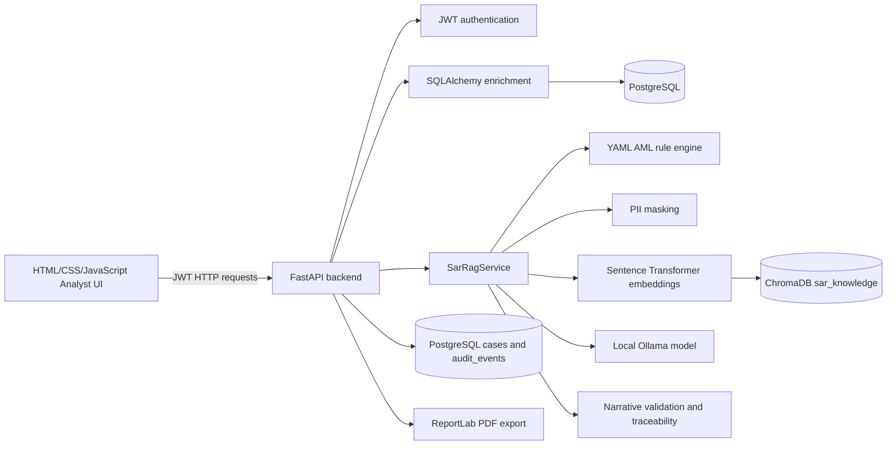

# Implemented Project Scope

## 1. Document Purpose

This document records the part of the project that is implemented in the current repository. It is intended to accompany the larger project synopsis, **A Hybrid Fraud Detection and Retrieval Augmented Suspicious Activity Report Generation Framework with Blockchain-Based Audit Integrity**.

The current implementation is an end-to-end local prototype for AML alert review and SAR narrative drafting. It combines deterministic AML rules, database-backed customer and transaction enrichment, retrieval-augmented generation, narrative validation, analyst review, audit storage, and PDF export.

The implementation described here is the delivered repository behavior. It does not claim that the full future scope described in the synopsis has already been completed.

## 2. Current Capability Summary

Implemented capabilities:

- JSON alert ingestion through a protected FastAPI API and a browser-based upload screen.
- JWT bearer authentication for analyst, manager, and admin demo users.
- PostgreSQL persistence for customer, account, transaction, case, and audit data.
- SQLAlchemy models for KYC and transaction enrichment entities.
- Twelve-month historical enrichment and alert-window transaction analysis.
- YAML-configured AML rule evaluation with rule-level confidence and regulatory reasons.
- Deterministic aggregate risk score and `LOW`, `MEDIUM`, or `HIGH` risk level.
- PII masking before retrieval and LLM prompt construction.
- ChromaDB vector retrieval over compliance guidance, typologies, templates, and example narratives.
- Local Ollama narrative generation using a strict JSON prompt contract.
- Structured sentence output with transaction-level evidence references.
- Post-generation validation for paragraph structure, evidence, numbers, PII, placeholders, typology, and filing language.
- Analyst editing, approve/reject decisions, mandatory comments, and edit diffs.
- Case replay using the stored prompt bundle and model configuration.
- Chronological audit events for ingestion, rules, retrieval, generation, validation, review, export, failure, and replay.
- Sanitized PDF report generation with dynamic review status and reproducibility metadata.
- Plain HTML, CSS, and JavaScript analyst screens for login, case creation, dashboard, review, and audit inspection.
- Automated tests for core API flows and the standalone SAR safety utilities.

## 3. Architecture



### 3.1 Request ownership

`backend/app.py` owns the HTTP boundary, authentication, orchestration, persistence calls, review lifecycle, replay endpoint, and PDF rendering. It delegates domain work rather than embedding rule or retrieval logic in the route handlers.

`backend/enrichment.py` owns database-backed customer and transaction analysis.

`rag_pipeline/rule_engine.py` owns YAML loading, condition evaluation, evidence block construction, risk scoring, and RAG query construction.

`rag_pipeline/pipeline_service.py` owns the RAG and narrative lifecycle, including masking, retrieval, prompt construction, model calls, parsing, validation, and sentence traceability.

`rag_pipeline/ingestion_pipeline.py` builds the ChromaDB knowledge collection from the text corpus.

`backend/database.py` owns SQLAlchemy enrichment models and direct PostgreSQL persistence for cases and audit events.

## 4. End-to-End Case Flow

For an authenticated `POST /cases` request, the current flow is:

1. Pydantic validates the incoming alert shape. Extra alert fields are allowed by `AlertPayload`.
2. `enrich_case()` looks up the customer and all linked accounts in PostgreSQL.
3. The enrichment layer selects a twelve-month window relative to the latest known transaction and derives alert-window transactions.
4. The alert is normalized with the enriched occupation, monthly income, historical deposit average, transaction count, inflow, and destination country.
5. The original alert and a masked copy are stored as the initial case record.
6. The YAML rule engine evaluates all configured rules and produces one evidence block for each match.
7. Rule confidence values are averaged into a risk score and mapped to a risk level.
8. When no rules fire, the pipeline returns `NO_SAR_REQUIRED` without invoking retrieval or the LLM.
9. When rules fire, a retrieval query is constructed from rule names, observations, alert pattern, and alert type.
10. Three relevant ChromaDB documents are retrieved and truncated to the configured RAG chunk limit before entering the prompt.
11. The prompt requests exactly five narrative paragraphs and a sentence array containing evidence IDs and sentence types.
12. Ollama generates the narrative locally. The service retries generation once if the structured response is too short or lacks sufficient real transaction evidence.
13. The response is parsed, normalized, stripped of unsupported placeholders and PII, and checked against the validation contract.
14. Sentence traceability is built by matching narrative sentences to fired rule keywords, transaction fields, or retrieved documents.
15. The final SAR payload, validation payload, prompt metadata, retrieval metadata, evidence pack, and audit events are persisted.
16. An analyst can inspect, edit, approve, reject, replay, audit, and export the case.

## 5. Alert Contract

The main request model is `AlertPayload` in `backend/schemas.py`:

```json
{
  "alert_id": "ALERT_7821",
  "customer_id": "CUST_1001",
  "customer_name": "Arjun Malhotra",
  "account_type": "current",
  "customer_profile": "Student",
  "alert_type": "Layering",
  "transactions": {
    "transaction_count": 28,
    "total_amount": 1450000,
    "time_window_days": 3,
    "destination_country": "UAE",
    "reporting_threshold": 1000000
  },
  "pattern": "high velocity pass-through layering with rapid outbound remittance"
}
```

`Transactions` also supports optional minimum amount, maximum amount, and reporting threshold fields. Optional customer financial fields include declared monthly income, twelve-month average deposits, and a historical baseline transaction count.

## 6. Database and Enrichment Implementation

### 6.1 Enrichment tables

SQLAlchemy creates these tables:

| Table | Main fields | Purpose |
| --- | --- | --- |
| `customers` | `customer_id`, `name`, `occupation`, `monthly_income`, `risk_rating` | KYC and customer risk context |
| `accounts` | `account_id`, `customer_id`, `account_type`, `opened_date` | Customer-account relationships |
| `transactions` | `txn_id`, `account_id`, `amount`, `txn_type`, `country`, `timestamp`, `counterparty` | Historical transaction evidence |

### 6.2 Case and audit tables

`cases` stores the original and masked alert payloads, status, risk result, evidence pack, retrieval payload, prompt payload, validation payload, final SAR, analyst review, replay result, and timestamps.

`audit_events` stores ordered event records linked to a case. Event payloads are JSONB, allowing the system to preserve the relevant intermediate artifacts without flattening them into a single narrative.

### 6.3 Derived enrichment

For a known customer, enrichment calculates:

- Twelve-month historical average credit inflow.
- Percentage deviation of alert-window inflow from that historical average.
- Alert-window transaction count and total credit inflow.
- Dominant debit destination country.
- Unique counterparties in the alert window.
- Prior counterparties observed before the alert window.
- New counterparties and whether a prior relationship exists.
- Full twelve-month transaction payload and alert-window transaction payload.

Unknown customers and customers without accounts receive a minimal fallback enrichment object so the pipeline remains callable, but their historical metrics are empty or zero-valued.

## 7. Deterministic AML Rule Engine

Rules are loaded from the root `rules.yaml`. The engine creates a context containing raw alert values, transaction values, thresholds, high-risk countries, customer profile limits, and derived values such as average transaction amount and transactions per day.

Supported condition types are:

- `gt`, `ge`, `lt`, `le`, `eq`, and `ne` comparisons.
- `between_exclusive` range checks.
- `in_list` membership checks.
- `contains_substring` pattern checks.
- `non_empty` presence checks.

The current configuration includes rules for:

- Structuring and smurfing.
- High transaction velocity.
- Below-threshold structuring.
- Large-value activity.
- Customer profile inconsistency.
- High-risk jurisdiction transfer.
- Rapid movement and layering.
- Deposit aggregation followed by transfer.
- Round tripping.
- Cash-intensive activity.
- Multi-account layering.
- Confirmed structuring pattern.
- Account type mismatch.

Each triggered rule returns an evidence block containing its rule ID, name, confidence, rendered observation, explanation, threshold, actual value, and regulation reference.

Risk scoring is deterministic: the average confidence of all triggered rules is used as the score. Scores of at least `0.80` are `HIGH`, scores of at least `0.60` are `MEDIUM`, and lower non-zero scores are `LOW`. No triggered rules produces `0.0` and `LOW`.

## 8. RAG Knowledge Pipeline

The source corpus is under `data/` and currently includes:

- AML typologies.
- Regulatory writing guidelines.
- SAR narrative templates.
- Example SAR narratives.

`ingestion_pipeline.py` performs the following operations:

1. Loads `.txt` files from the configured data folder.
2. Detects document type using content signals.
3. Chunks text by delimiter or paragraphs, depending on structure.
4. Deduplicates chunks using a normalized SHA-256 content hash.
5. Adds metadata such as source, type, word count, jurisdiction, typology, regulation, example, and template flags.
6. Embeds chunks with `all-MiniLM-L6-v2`.
7. Rebuilds the `sar_knowledge` collection in persistent ChromaDB.
8. Verifies retrieval with representative queries.

At runtime, the service uses the same embedding model to query the persistent collection. The three closest results are recorded with IDs, distances, similarity scores, metadata, a corpus snapshot, and a retrieval timestamp.

Retrieved text is reference material. The prompt explicitly tells the model not to copy figures from example documents and to use only the exact alert and enrichment values for the generated case.

## 9. Privacy and Safety Controls

### 9.1 Prompt-time masking

Before retrieval and generation, the customer name is transformed into an initial-plus-mask form and the customer ID is partially masked. The LLM prompt instructs the model to use generic phrases such as “the account holder” and never include the raw name or ID.

### 9.2 Main pipeline validation

`SarRagService._validate_narrative()` checks:

- Exactly five paragraphs.
- Word count between 150 and 500.
- No customer name or customer ID.
- No unresolved bracket placeholders.
- Correct alert typology.
- Paragraph prose rather than bullet formatting.
- Filing language with SAR and FIU references.
- All narrative numbers belong to the supplied evidence values.
- Every sentence contains a real `TXN_` reference.
- Structured sentence evidence is non-empty.
- Structured evidence IDs are real IDs from enrichment.
- No vague wording such as “multiple”, “several”, “various”, “many”, or “some”.
- Reasoning terms such as “indicating” or “suggesting”.

The PII check is a hard block: a generated narrative containing the customer name or ID raises an error before the case is stored as a completed result.

### 9.3 Standalone safety module

`sar_safety.py` provides a separately tested safety wrapper with name-variant PII detection, evidence-anchor coverage checks, retry with backoff, structured `SarSafetyViolation` errors, and an audit trail. Its anchor format is `[E1]` or `(E1)`. The integrated `SarRagService` currently uses the newer real-transaction-ID JSON evidence contract instead of calling this module directly.

### 9.4 PDF defense in depth

Before ReportLab rendering, the backend removes evidence tags, formats ISO timestamps, and strips raw customer name and ID from narrative prose. The PDF still displays verified identity fields in the designated report metadata area. Its footer and review box reflect `APPROVE`, `REJECT`, or pending status.

## 10. Structured Explainability

The generated SAR stores sentence objects shaped like this:

```json
{
  "text": "The account received 57 credits in 3 days, compared with its historical monthly pattern, indicating abnormal activity.",
  "evidence": ["TXN_00031", "TXN_00032"],
  "type": "transaction_data"
}
```

Supported sentence types are `transaction_data`, `reference_knowledge`, and `evidence_not_available`.

Evidence buckets are derived from real enrichment transactions:

- `high_velocity_txns` contains alert-window transaction IDs.
- `uae_transfers` contains alert-window transactions whose country is UAE.
- `structuring_txns` contains transactions below the configured reporting threshold.

The sentence traceability view separately maps sentences to fired rules, transaction fields, retrieved documents, or an unmatched state. Unmatched sentences are flagged for analyst review.

## 11. API Surface

Base URL: `http://localhost:8000`

| Method | Route | Auth | Behavior |
| --- | --- | --- | --- |
| `GET` | `/health` | No | Service health and timestamp |
| `POST` | `/login` | No | Returns a JWT access token and role |
| `GET` | `/cases` | Bearer JWT | Lists cases ordered by risk and update time |
| `POST` | `/cases` | Bearer JWT | Enriches, evaluates, generates, validates, and stores a case |
| `GET` | `/cases/{case_id}` | Bearer JWT | Returns full case data plus audit events |
| `GET` | `/cases/{case_id}/audit` | Bearer JWT | Returns chronological audit events |
| `POST` | `/cases/{case_id}/review` | Bearer JWT | Saves analyst decision, comment, optional edited narrative, and diff |
| `POST` | `/cases/{case_id}/replay` | Bearer JWT | Re-runs generation from the stored prompt bundle |
| `GET` | `/cases/{case_id}/export/pdf` | Bearer JWT | Streams a sanitized PDF report |

The demo credentials are `analyst`, `manager`, and `admin`, each using `password123`. These credentials and the JWT secret are development defaults and must be replaced for any real deployment.

## 12. Frontend Workflow

The frontend is a static browser application served independently from the API:

1. `index.html` authenticates and stores the JWT in `sessionStorage`.
2. `new_case.html` accepts drag-and-drop or file-selection of alert JSON, previews flattened fields, and submits the alert.
3. `dashboard.html` displays case totals, high-risk count, pending review count, approved count, SLA age, review links, audit links, and PDF download actions.
4. `review.html` displays triggered rules, five editable narrative sections, sentence explainability styling, validation checks, mandatory review comments, approve/reject controls, and replay diff.
5. `audit.html` displays the event timeline and expandable JSON payloads.
6. `api.js` centralizes authenticated fetch calls, handles expired sessions, parses JSON/PDF responses, and exposes the API operations used by the pages.

## 13. Supporting Scripts

- `scripts/ensure_local_postgres.py` parses `DATABASE_URL`, connects to the PostgreSQL admin database, and creates the configured application database if absent.
- `scripts/seed_data.py` creates four customers, four accounts, and deterministic demo transactions, including a high-velocity pass-through pattern with UAE debits for `CUST_1001`.
- `scripts/calculate_llm_tokens.py` estimates prompt and retrieval token usage and includes Ollama runtime token counters when available.
- `rag_pipeline/ingestion_pipeline.py` refreshes the local ChromaDB collection.

## 14. Local Setup

Prerequisites:

- Python 3.10 or newer.
- PostgreSQL running locally.
- Ollama installed and serving a pulled model.

Typical PowerShell setup:

```powershell
python -m venv .venv
.venv\Scripts\activate
pip install -r requirements.txt
copy .env.example .env
python scripts/ensure_local_postgres.py
python scripts/seed_data.py
ollama pull mistral:7b
Push-Location rag_pipeline
python ingestion_pipeline.py
Pop-Location
uvicorn backend.app:app --reload
```

In another terminal, serve the static frontend:

```powershell
Push-Location frontend
python -m http.server 8080
Pop-Location
```

The API is available at `http://localhost:8000`, Swagger UI at `http://localhost:8000/docs`, and the frontend at `http://localhost:8080`.

Configuration is read from `.env`. The main settings are `DATABASE_URL`, `POSTGRES_ADMIN_DB`, `OLLAMA_MODEL`, and `CHROMA_DB_PATH`.

The supplied `.env.example` selects `mistral:7b`, matching the project synopsis. If `OLLAMA_MODEL` is not set, `pipeline_service.py` falls back to `phi3:mini`.

## 15. Verification and Test Coverage

Run the existing suite with:

```powershell
pytest -q
```

The backend tests cover:

- Successful and failed login.
- Authentication protection of case routes.
- Case creation and risk-level response.
- Review validation and successful review persistence.
- PDF response content type.
- PII-safe phrase enrichment behavior.

The SAR safety tests cover:

- Full, partial, and case-insensitive name detection.
- Evidence-anchor coverage.
- Retry after PII or evidence failures.
- Maximum retry violations.
- Generation exceptions.
- Partial-evidence soft acceptance.
- Customer ID leaks.
- Audit event ordering and error response shape.

The tests use in-memory monkeypatched persistence for API behavior, so they do not replace an integration test against a live PostgreSQL database, ChromaDB collection, or Ollama server.

## 16. Current Boundaries and Not-Yet-Implemented Scope

The following items belong to the larger project vision but are not implemented as production components in this repository:

- Blockchain or distributed-ledger audit anchoring. Audit events are stored in PostgreSQL JSONB tables; there is no chain, wallet, smart contract, consensus mechanism, or hash anchoring service.
- Network or graph-based fraud detection across multiple accounts and counterparties. The current detector evaluates one normalized alert with customer history and counterparty counts; it does not construct or score a transaction graph.
- Isolation Forest anomaly detection and NetworkX graph-based detection, including cycle and fan-in/fan-out analysis. The current implementation has no learned anomaly score, transaction graph, or composite score across these layers; risk scoring is rule-confidence averaging.
- Production identity, role-based authorization, secret management, password hashing, token expiry, refresh tokens, and external identity-provider integration. Demo credentials and a static JWT secret are embedded in the backend.
- Production deployment artifacts, containerization, migrations, observability, queue-based processing, horizontal scaling, and managed model/vector infrastructure.
- Automatic regulatory submission to FIU or any external case-management or core-banking system. The current approval flow ends at local export readiness and PDF download.
- A full adversarial evaluation set or model-quality benchmark. Current validation is deterministic and the tests are focused on API and safety utilities.

These boundaries are deliberate documentation of the present milestone, not failures of the implemented local workflow.

## 17. Repository Map

```text
IMPLEMENTED_SCOPE.md       This implementation and architecture record
README.md                   Existing setup and capability overview
backend/app.py              API, orchestration, review, replay, and PDF export
backend/database.py        ORM models and PostgreSQL case/audit persistence
backend/enrichment.py      KYC and transaction enrichment
backend/schemas.py         Request and response models
data/                      RAG source corpus and sample alert
rules.yaml                 AML rule configuration
rag_pipeline/rule_engine.py
                            YAML rule evaluation and risk scoring
rag_pipeline/ingestion_pipeline.py
                            Corpus chunking, embedding, and Chroma ingestion
rag_pipeline/pipeline_service.py
                            RAG retrieval, Ollama generation, validation, and traceability
sar_safety.py              Standalone PII/evidence retry safety layer
frontend/                  Static analyst workflow
scripts/                   Database, seed, ingestion, and token utilities
tests/                     Backend and safety test suites
```
