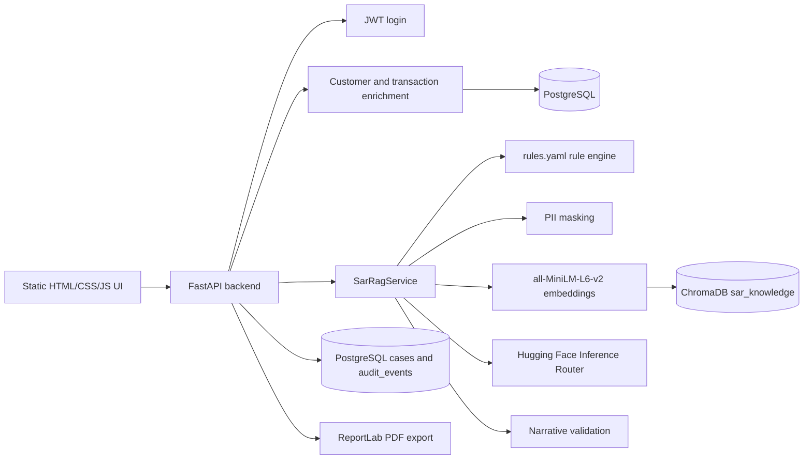

# SAR Narrative Generator: System Working Guide

## 1. Purpose

This application is an analyst workflow for investigating AML alerts and drafting Suspicious Activity Reports (SARs). It combines:

1. Deterministic AML rules for repeatable detection.
2. PostgreSQL-backed KYC and transaction enrichment.
3. Retrieval-Augmented Generation (RAG) over compliance knowledge.
4. A Hugging Face hosted language model for narrative drafting.
5. Deterministic validation and transaction-level evidence mapping.
6. Analyst review, audit logging, replay, and PDF export.

The system is an end-to-end local prototype. It is not an automatic regulatory filing system.

## 2. High-Level Architecture



### Main ownership by module

| Module | Responsibility |
| --- | --- |
| `frontend/index.html` | Login screen and JWT acquisition |
| `frontend/new_case.html` | Alert JSON upload, preview, and case submission |
| `frontend/dashboard.html` | Case list, risk summary, review links, audit links, PDF download |
| `frontend/review.html` | Narrative review, validation display, edit, approve, reject, replay |
| `frontend/audit.html` | Audit event timeline |
| `frontend/api.js` | Authenticated browser API requests |
| `backend/app.py` | HTTP routes, authentication, workflow orchestration, review, PDF export |
| `backend/enrichment.py` | KYC and transaction intelligence from PostgreSQL |
| `backend/database.py` | Database models, table initialization, case and audit persistence |
| `rag_pipeline/rule_engine.py` | YAML rule loading, condition evaluation, evidence blocks, risk score |
| `rag_pipeline/ingestion_pipeline.py` | Knowledge-file chunking, embedding, and ChromaDB creation |
| `rag_pipeline/pipeline_service.py` | Masking, rules, retrieval, prompt construction, Hugging Face calls, parsing, validation |
| `rules.yaml` | Active AML rule configuration |
| `data/*.txt` | RAG knowledge corpus |

## 3. End-to-End Case Flow

A case starts when the browser sends `POST /cases` with an alert JSON document.

### Step 1: Login

The analyst logs in at the frontend with one of the demo users:

```text
analyst / password123
manager / password123
admin / password123
```

`POST /login` returns a JWT. The browser stores it in `sessionStorage` and sends it as:

```text
Authorization: Bearer <token>
```

### Step 2: Alert upload

The analyst uploads `data/alert_case.json` or another compatible JSON file in `new_case.html`. The browser parses the file locally, displays a flattened preview, and sends the JSON to the backend.

A typical alert contains:

```json
{
  "alert_id": "ALERT_7821",
  "customer_id": "CUST_1001",
  "customer_name": "Arjun Malhotra",
  "account_type": "current",
  "customer_profile": "Student",
  "alert_type": "Layering",
  "transactions": {
    "transaction_count": 28,
    "total_amount": 1450000,
    "time_window_days": 3,
    "destination_country": "UAE",
    "reporting_threshold": 1000000
  },
  "pattern": "high velocity pass-through layering with rapid outbound remittance"
}
```

The incoming model is validated by Pydantic. The API then creates an initial database case with status `INGESTED` before running the generation pipeline.

### Step 3: PostgreSQL enrichment

`backend/enrichment.py` uses `customer_id` to find the customer and related accounts. It then reads the customer's transactions and determines a reference period using the latest known transaction.

For known customers, it calculates:

- Twelve-month transaction history.
- Alert-window transactions.
- Alert-window transaction count.
- Alert-window credit inflow.
- Twelve-month average monthly credit deposits.
- Percentage deviation from that historical average.
- Dominant debit destination country.
- Unique counterparties in the alert window.
- Prior counterparties before the alert window.
- New counterparties.
- Whether a prior counterparty relationship exists.

The API adds these values to the alert before rule evaluation and generation. It also updates key transaction fields with database-derived values when available.

For the seeded suspicious customer `CUST_1001`, the data represents high-velocity credits followed by UAE debits, which is intended to trigger layering-related rules.

If a customer is unknown or has no account, the enrichment layer returns a minimal fallback object. This keeps the pipeline callable but provides little historical intelligence.

### Step 4: PII masking

The original alert is retained for controlled case storage and export, but the version sent to retrieval and the language model is masked:

- Customer names become an initial-plus-mask form.
- Customer IDs are partially masked.
- The prompt instructs the model to write `the account holder` or `the customer`, never the raw identity.

The generated narrative is checked for customer name and customer ID leakage. A leak causes the case processing result to fail rather than silently accepting unsafe output.

## 4. AML Rule Engine

### 4.1 Rule source

The active rule file is the root `rules.yaml`. The file contains:

- Default values.
- Thresholds.
- High-risk countries.
- Customer-profile maximum amounts.
- Individual AML rules.

`data/aml_rules.yaml` is a dataset/reference copy. The runtime engine loads the root `rules.yaml`.

### 4.2 Rule context

Before evaluating a rule, the engine builds a context containing:

```text
alert       Original alert object
customer    Customer fields from the alert
 txn        Transaction summary
thresholds  Values from rules.yaml
high_risk_countries
 derived     Calculated values
```

Important derived values include:

```text
avg_amount       = total_amount / transaction_count
 txn_per_day      = transaction_count / time_window_days
 lower_band      = 70% of reporting threshold
 upper_band      = reporting threshold
 expected_max    = profile-specific maximum
 destination     = uppercase destination country
 pattern_lower   = lowercase alert pattern
```

### 4.3 Supported condition types

The engine supports these YAML condition types:

- `gt`: greater than
- `ge`: greater than or equal to
- `lt`: less than
- `le`: less than or equal to
- `eq`: equal to
- `ne`: not equal to
- `between_exclusive`: strictly between two values
- `in_list`: value appears in a configured list
- `contains_substring`: text contains a configured substring
- `non_empty`: value is present

A rule with multiple conditions requires all conditions to pass. Rules can also define `any_conditions` for an OR-style check.

### 4.4 Active rules

| ID | Rule | How it triggers |
| --- | --- | --- |
| `AML-001` | Structuring / Smurfing | Transaction count exceeds `structuring_txn_count` |
| `AML-002` | High Velocity Transactions | Transactions per day exceeds `velocity_per_day` |
| `AML-003` | Below Threshold Structuring | Average amount falls strictly between 70% and 100% of the reporting threshold |
| `AML-004` | Large Value Transaction | Total amount exceeds `large_amount` |
| `AML-005` | Profile Inconsistency | Total amount exceeds the profile's expected maximum |
| `AML-006` | High Risk Jurisdiction Transfer | Destination appears in `high_risk_countries` |
| `AML-007` | Rapid Fund Movement / Layering | Transfer occurs within the configured rapid-movement window and has a destination |
| `AML-008` | Deposit Aggregation Then Transfer | Alert pattern contains the configured phrase |
| `AML-009` | Round Tripping | Alert pattern contains `round trip` |
| `AML-010` | Cash Intensive Activity | Alert pattern contains `cash deposit` |
| `AML-011` | Multi Account Layering | Alert pattern contains `multiple accounts` |
| `AML-012` | Confirmed Structuring Pattern | Alert pattern contains `structuring` |
| `AML-013` | Account Type Mismatch | Savings account has more than 15 transactions |

### 4.5 Evidence block

Every matched rule becomes an evidence block containing:

- Rule ID.
- Rule name.
- Confidence.
- Rendered observation.
- Why the rule was flagged.
- Regulation reference.
- Threshold.
- Actual value.

Example:

```json
{
  "rule_id": "AML-002",
  "rule_name": "High Velocity Transactions",
  "confidence": 0.95,
  "observation": "19.0 transactions per day average over 3 days",
  "audit_reason": {
    "why_flagged": "Velocity 19.0 txn/day exceeds RBI threshold of 5 txn/day",
    "regulation": "RBI AML Guidelines - Velocity Check",
    "threshold": 5,
    "actual_value": 19.0
  }
}
```

### 4.6 Confidence and risk level

Some rules have fixed confidence values. Others use a scaled calculation:

```text     
raw_confidence = actual_value / threshold * multiplier
confidence = minimum(raw_confidence, cap)
```

The final risk score is the average confidence of all triggered rules:

```text
risk_score = sum(triggered rule confidence) / number of triggered rules
```

Risk mapping:

| Score | Risk level |
| --- | --- |
| `0.80` or higher | `HIGH` |
| `0.60` to below `0.80` | `MEDIUM` |
| Above zero and below `0.60` | `LOW` |
| No triggered rules | `LOW`, score `0.0` |

If no rule fires, the pipeline returns `NO_SAR_REQUIRED` and skips RAG retrieval and LLM generation.

## 5. Knowledge Base and RAG

### 5.1 Knowledge-base source files

The RAG corpus is stored in `data/`:

| File | Knowledge provided |
| --- | --- |
| `aml_typologies.txt` | AML typology descriptions and indicators |
| `regulatory_writing_guidelines.txt` | Compliance writing style, approved language, and prohibited wording |
| `sar_narrative_templates.txt` | Reusable structure and wording patterns for SAR sections |
| `example_sar_narratives.txt` | Example narratives used as style references |

The alert JSON and PostgreSQL transactions are not the knowledge corpus. They are case-specific evidence supplied at runtime.

### 5.2 Ingestion process

Run the ingestion script from the project root:

```powershell
cd D:\Hackathon\Barclays\rag_pipeline
python ingestion_pipeline.py
```

The script:

1. Finds `.txt` files in the configured data folder.
2. Detects a document type from content signals.
3. Splits text by `---` delimiters or paragraphs.
4. Breaks very long sections into smaller chunks.
5. Removes duplicate chunks using a normalized SHA-256 content hash.
6. Adds metadata to each chunk.
7. Embeds chunks using `all-MiniLM-L6-v2`.
8. Rebuilds the persistent ChromaDB collection named `sar_knowledge`.
9. Runs representative retrieval queries to verify the collection.

Metadata includes:

```text
type              example, template, typology, guideline, or general
source            source filename
chunk_index       position within the source file
word_count        chunk size
has_jurisdiction  jurisdiction keyword detected
has_typology      typology keyword detected
has_regulation    regulatory keyword detected
is_example        whether the chunk is an example
is_template       whether the chunk is a template
```

The first ingestion can be slow because `all-MiniLM-L6-v2` may need to download and initialize. The model is cached afterward.

### 5.3 Runtime retrieval

When rules fire, the service builds a retrieval query from:

- Triggered rule names.
- Rule observations.
- The alert pattern.
- The alert type.
- A request for regulatory writing guidance and example SAR language.

The service embeds that query with the same `all-MiniLM-L6-v2` model and queries ChromaDB for the three closest documents.

Each retrieved item records:

- Chroma document ID.
- Document text, truncated to the configured maximum.
- Distance.
- Similarity score.
- Source metadata.

Retrieved documents guide terminology and structure. The prompt explicitly tells the model not to copy figures from examples. Case numbers must come from the alert and enrichment data.

## 6. Hugging Face Narrative Generation

The current LLM provider is configured in `.env`:

```env
LLM_PROVIDER=huggingface
HF_MODEL=openai/gpt-oss-120b:fastest
HF_CHAT_URL=https://router.huggingface.co/v1/chat/completions
HF_MAX_TOKENS=2400
HF_API_TOKEN=your_token_here
```

The code sends a chat-completions request containing:

- A system prompt defining the AML analyst role.
- A user prompt containing the case-specific transaction data.
- Triggered rules and their explanations.
- Counterparty intelligence.
- Real transaction-ID evidence buckets.
- Retrieved compliance knowledge.
- The five-paragraph output contract.

The generation request uses:

```json
{
  "temperature": 0.2,
  "top_p": 0.9,
  "max_tokens": 2400,
  "response_format": {"type": "json_object"},
  "reasoning_effort": "low"
}
```

Ollama is not required for the current configuration. The legacy Ollama branch remains in the service code only as an optional provider path, but `requirements.txt` no longer requires the Ollama package.

### Required generated structure

The model is asked to return JSON containing:

```json
{
  "paragraphs": [
    "Background paragraph",
    "Transaction summary paragraph",
    "Typology paragraph",
    "Evidence paragraph",
    "Conclusion paragraph"
  ],
  "sentences": [
    {
      "sentence": "A factual sentence with reasoning.",
      "evidence": ["TXN_00031"],
      "type": "transaction_data"
    }
  ]
}
```

The five paragraphs cover:

1. Background and customer profile.
2. Transaction summary.
3. Typology analysis.
4. Evidence and transaction references.
5. Conclusion and filing statement.

The sentence list supports explainability. Each sentence should point to real transaction IDs from the enrichment data.

## 7. Narrative Parsing and Normalization

The service parses the JSON returned by Hugging Face and then:

1. Extracts sentence objects.
2. Removes unsupported placeholders.
3. Removes raw customer names and IDs.
4. Assigns real transaction IDs when a model sentence has no evidence but alert-window transactions exist.
5. Adds a transaction ID to the sentence text when necessary for the strict evidence check.
6. Groups sentence text into five paragraphs.
7. Preserves blank lines between paragraphs for the review UI.
8. Produces the final narrative string and structured sentence list.

This normalization exists because a language model may return valid JSON while still placing all prose in one paragraph or omitting an evidence ID. The application repairs the structure locally using the verified transaction data instead of inventing evidence.

## 8. Validation and Safety Checks

`SarRagService._validate_narrative()` runs after generation.

The checks include:

- Exactly five paragraphs.
- Word count between 150 and 500.
- Customer name absent.
- Customer ID absent.
- No unresolved square-bracket placeholders.
- Correct alert typology appears.
- No bullet formatting.
- Filing language includes SAR and FIU references.
- Every number belongs to an allowed alert or enrichment value.
- Every sentence contains a real `TXN_` reference.
- Structured sentence evidence arrays are not empty.
- Every evidence ID exists in the alert-window enrichment data.
- No vague terms such as `multiple`, `several`, `various`, `many`, or `some`.
- Reasoning language such as `indicating`, `suggesting`, `consistent with`, or `demonstrating`.

The validation result is stored as:

```json
{
  "passed": true,
  "checks": [],
  "failed_checks": [],
  "validation_errors": [],
  "validated_at": "..."
}
```

The frontend displays each check with a pass or fail indicator. Analysts can inspect failed checks before approving a case.

The standalone `sar_safety.py` module provides additional utilities for name-variant PII detection, evidence-anchor coverage, retries, and structured safety errors. The current integrated pipeline primarily uses the newer real transaction-ID validation in `pipeline_service.py`.

## 9. Sentence-Level Explainability

The system stores two related explainability views.

### Structured sentence evidence

This is the model-facing contract:

```json
{
  "text": "The account transferred funds to UAE within three days, indicating rapid movement.",
  "evidence": ["TXN_00032", "TXN_00034"],
  "type": "transaction_data"
}
```

Supported types are:

- `transaction_data`
- `reference_knowledge`
- `evidence_not_available`

Evidence buckets include:

- `high_velocity_txns`: alert-window transactions.
- `uae_transfers`: alert-window transactions with country `UAE`.
- `structuring_txns`: transactions below the configured reporting threshold.

### Traceability mapping

The service separately maps each narrative sentence to the strongest available source:

1. A fired AML rule whose keywords appear in the sentence.
2. A transaction field such as amount, count, velocity, or destination.
3. A retrieved compliance document.
4. An unmatched source requiring analyst attention.

The review screen uses this traceability data to color sentences by explainability score.

## 10. Persistence and Audit Trail

### PostgreSQL tables

The application initializes tables automatically when the backend starts.

SQLAlchemy enrichment tables:

- `customers`
- `accounts`
- `transactions`

Direct SQL case tables:

- `cases`
- `audit_events`

A case stores:

- Original alert payload.
- Masked alert payload.
- Status.
- Risk score and level.
- Evidence pack.
- Retrieval payload.
- Prompt metadata.
- Validation payload.
- Final SAR.
- Analyst review.
- Replay result.
- Created and updated timestamps.

Audit events record the major pipeline stages, including:

- `CASE_INGESTED`
- `RULES_EVALUATED`
- `RAG_RETRIEVAL_COMPLETED`
- `LLM_GENERATION_COMPLETED`
- `VALIDATION_COMPLETED`
- `CASE_READY_FOR_REVIEW`
- `CASE_FAILED`
- `ANALYST_REVIEW_SUBMITTED`
- `EXPORT_TRIGGERED`
- `CASE_REPLAYED`

## 11. Analyst Review Workflow

The analyst workflow is:

1. Log in.
2. Upload an alert JSON file.
3. Review the risk level and triggered rules.
4. Inspect the five generated narrative sections.
5. Review validation checks and sentence explainability.
6. Edit narrative sections if necessary.
7. Enter a mandatory comment of at least 10 characters.
8. Approve or reject the case.
9. Inspect the audit timeline.
10. Replay the stored prompt if reproducibility needs to be checked.
11. Download a sanitized PDF.

The review endpoint stores:

- Analyst ID.
- Decision.
- Comment.
- Edited narrative.
- Timestamp.
- Text diff between generated and analyst-edited content.

## 12. PDF Export

`GET /cases/{case_id}/export/pdf` generates a ReportLab PDF containing:

- Case and alert identifiers.
- Risk level and aggregate score.
- Identity verification section.
- Activity summary.
- Triggered rule table.
- Narrative sections.
- Analyst review decision.
- Audit and reproducibility metadata.

Before rendering narrative prose, the backend:

- Removes evidence tags.
- Formats ISO timestamps.
- Removes raw customer names and IDs from narrative text.
- Displays the verified identity fields only in the intended report area.
- Shows `APPROVED`, `REJECTED`, or `PENDING REVIEW` dynamically.

## 13. API Routes

| Method | Route | Purpose |
| --- | --- | --- |
| `GET` | `/health` | Health check |
| `POST` | `/login` | Obtain JWT |
| `GET` | `/cases` | List cases |
| `POST` | `/cases` | Create and process a case |
| `GET` | `/cases/{case_id}` | View full case |
| `GET` | `/cases/{case_id}/audit` | View audit events |
| `POST` | `/cases/{case_id}/review` | Approve, reject, or edit |
| `POST` | `/cases/{case_id}/replay` | Re-run stored prompt |
| `GET` | `/cases/{case_id}/export/pdf` | Download PDF |

Swagger documentation is available at:

```text
http://localhost:8000/docs
```

## 14. Running the System

Prerequisites:

- Python 3.10 or later.
- PostgreSQL installed and running.
- Hugging Face account and inference token.
- Internet access for Hugging Face requests and the first embedding-model download.

Setup:

```powershell
cd D:\Hackathon\Barclays
.\.venv\Scripts\Activate.ps1
pip install -r requirements.txt
python scripts/ensure_local_postgres.py
python scripts/seed_data.py
```

Build or refresh the vector store once:

```powershell
cd D:\Hackathon\Barclays\rag_pipeline
python ingestion_pipeline.py
```

Start the backend in one terminal:

```powershell
cd D:\Hackathon\Barclays
.\.venv\Scripts\Activate.ps1
uvicorn backend.app:app --reload
```

Start the frontend in another terminal:

```powershell
cd D:\Hackathon\Barclays\frontend
python -m http.server 8080
```

Open:

```text
http://localhost:8080
```

## 15. Current Boundaries

This repository does not currently implement:

- Blockchain or distributed-ledger audit anchoring.
- Automatic FIU submission.
- A production identity provider or full role-based permission system.
- Token expiry and refresh-token management.
- Network graph fraud detection across accounts.
- Isolation Forest anomaly detection.
- Production queue processing or horizontal scaling.
- Managed vector infrastructure.
- Database migrations.
- A comprehensive model-quality benchmark.

The current risk score is rule-confidence averaging. It is not a machine-learned fraud probability.

## 16. Important Security Notes

The current project contains development defaults:

- Demo usernames and passwords.
- A static JWT signing secret in `backend/app.py`.
- A Hugging Face token stored in `.env` for local use.

Never commit `.env` or expose the Hugging Face token. If a token is exposed, revoke it in Hugging Face settings and create a replacement token with only the required inference permissions.
