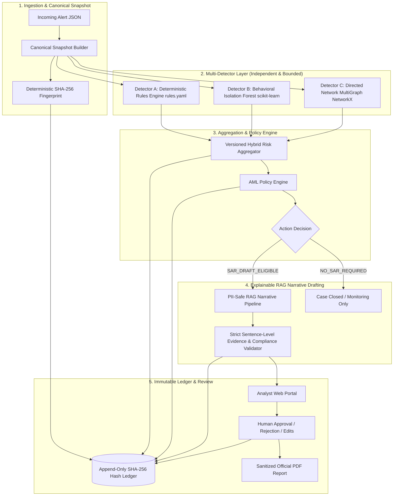
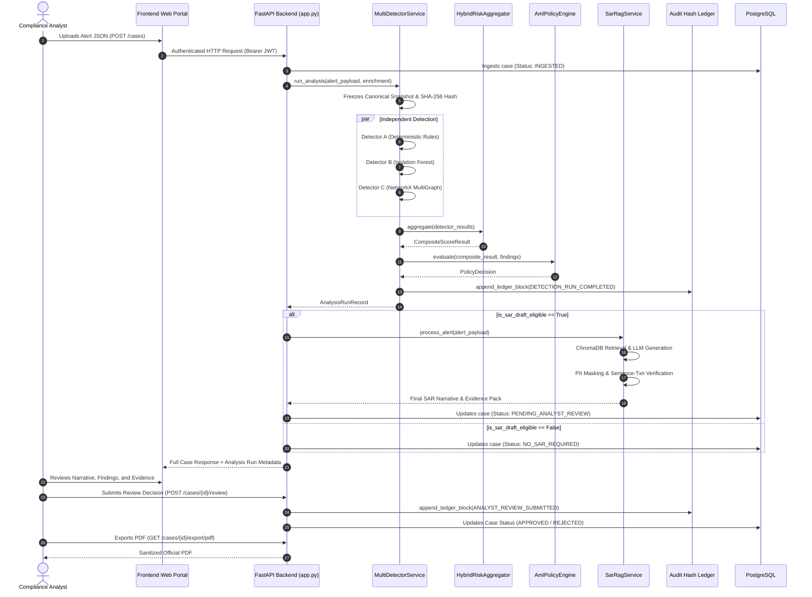

# System Architecture

## Hybrid AML Investigation, Fraud Detection, Explainable Risk Decisioning, and Tamper-Evident Audit Framework

---

## 1. System Overview & Core Philosophy

The platform is designed as an end-to-end, academic/hackathon-safe decision-support system for anti-money laundering (AML) compliance investigations. It is **not** an automated filing bot; all investigative outputs serve to empower qualified human compliance analysts, maintaining human-in-the-loop accountability as mandated by regulatory bodies (e.g., FIU-IND, FinCEN, FATF).

---

## 2. Component Boundaries & Responsibilities

| Subsystem | Package / File | Primary Responsibility |
|---|---|---|
| **Intake & Snapshot** | `detection/snapshot.py`, `backend/schemas.py` | Validates alert schema, normalizes transactions and amounts, enforces as-of time constraint, and produces a frozen canonical SHA-256 snapshot hash. |
| **Rule Engine (Layer A)** | `rules.yaml`, `rag_pipeline/rule_engine.py`, `detection/rules_adapter.py` | Evaluates deterministic AML thresholds (velocity, structuring, high-risk countries, customer profile limits), assigns rule confidence, and maps to standard `DetectionFinding` objects. |
| **Anomaly Detector (Layer B)** | `ml/features.py`, `ml/anomaly_detector.py` | Extracts 16 leakage-free temporal/behavioral features and runs an Isolation Forest estimator to identify statistical outliers without fabricating fraud probabilities. |
| **Graph Pattern Detector (Layer C)** | `graph/graph_detector.py` | Builds a directed `MultiDiGraph` with NetworkX to detect topological laundering motifs: rapid pass-through, bounded circular flows within SCCs, and fan-in/fan-out hubs. |
| **Hybrid Aggregator** | `detection/aggregator.py` | Combines individual detector outputs into a normalized composite score (`[0.0, 1.0]`) using validated weights (`0.35`, `0.25`, `0.40`), handling missing/failed detectors safely without converting failure to zero. |
| **Policy Engine** | `detection/policy.py` | Translates numerical scores and severity tiers into actionable compliance states (`SAR_DRAFT_ELIGIBLE`, `ANALYST_REVIEW_REQUIRED`, `NO_ADDITIONAL_REVIEW_TRIGGERED`, etc.). |
| **SAR RAG Narrative** | `rag_pipeline/pipeline_service.py`, `sar_safety.py` | Ingests verified findings, masks PII, queries ChromaDB for typologies/guidelines, and invokes the LLM under a strict 5-paragraph JSON schema with sentence-to-transaction ID traceability. |
| **Hash-Chained Audit Ledger** | `audit/ledger.py`, `scripts/verify_audit_ledger.py` | Implements an append-only cryptographic ledger (`prev_hash` -> `block_hash`), sequence continuity checking, tamper verification CLI/API, and honest trust boundary reporting. |
| **PDF Reporting** | `backend/app.py` | Renders official compliance reports with ReportLab, applying defense-in-depth PII scrubbing, dynamic review status watermarks, and cryptographic audit references. |

---

## 3. Sequence Flow: End-to-End Case Investigation

---

## 4. Error Handling & Incompleteness Guarantees

1. **No Silent Failure-to-Zero:** If any detector fails (e.g. database disconnect, corrupted graph input), its status is recorded as `FAILED` or `PARTIAL`. The aggregator flags a prominent data-quality warning and renormalizes over active detectors, ensuring the system never misinterprets a detector outage as a low-risk customer.
2. **Computational Time Budgets:** Graph cycle enumeration is bounded to strongly connected components (SCC) of length $\le 5$ and capped at a maximum of 3.0 seconds execution time to prevent Denial of Service (DoS).
3. **Audit Ledger Verification:** Read-only verification checks sequence continuity, payload hashes, and parent hashes. Tampering with any historical block immediately invalidates all subsequent blocks.
