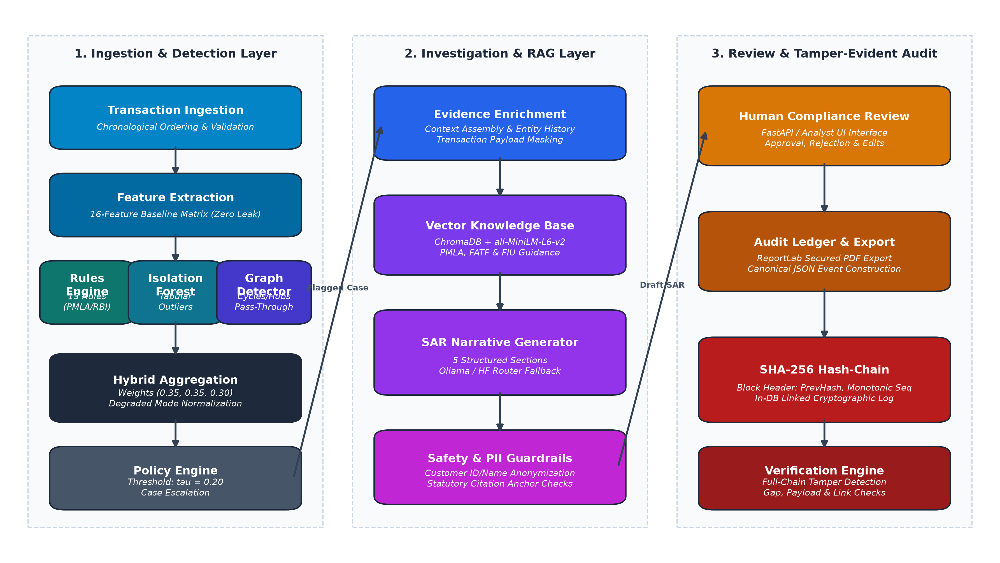
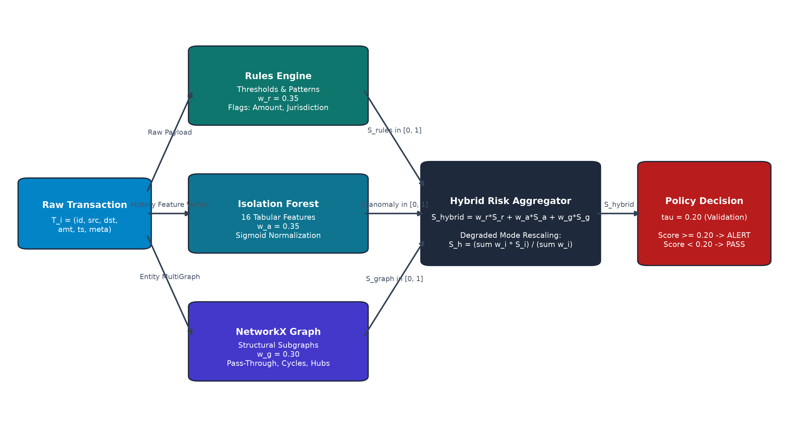
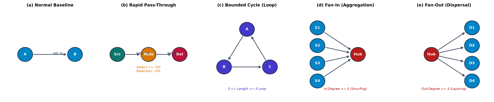
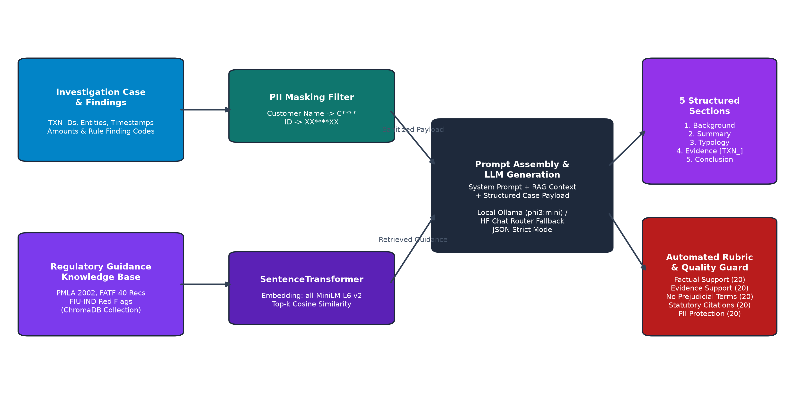
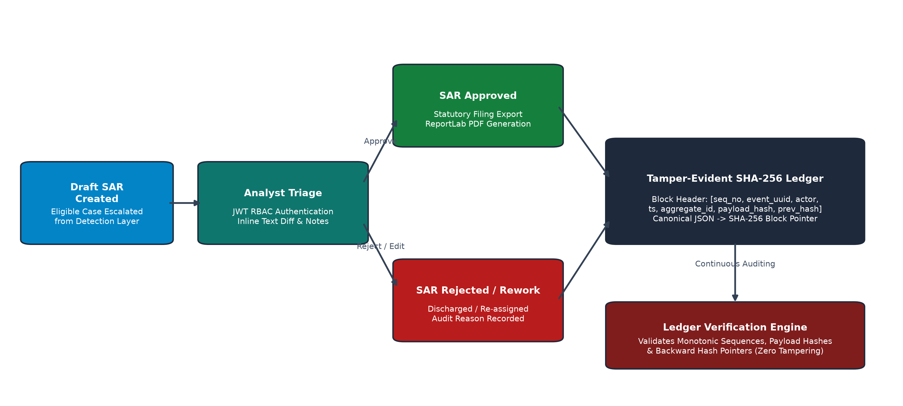
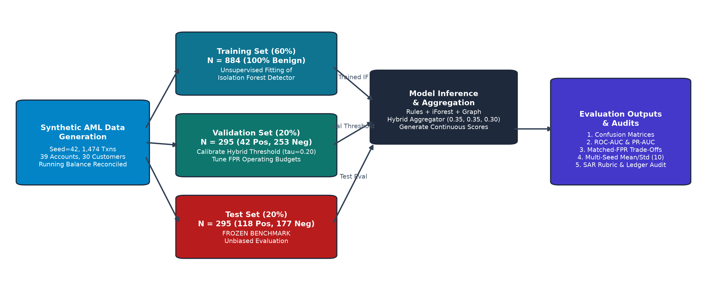
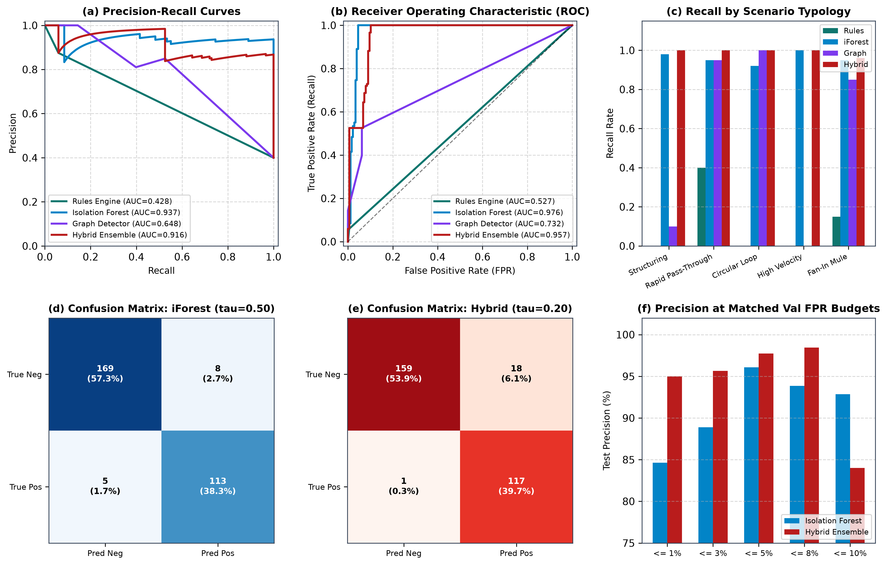

# A Hybrid AML Detection and Evidence-Grounded SAR Generation Framework with Tamper-Evident Audit Logging

**Author 1**\*, **Author 2**\*, **Author 3**\*  
*\*Department of Computer Science and Engineering, Institution Placeholder*  
*Correspondence: `corresponding-author@institution.edu`*  

---

### Abstract

Anti-Money Laundering (AML) monitoring in contemporary financial institutions is severely constrained by three systemic vulnerabilities: extreme false-positive alert rates in threshold rules, siloed analytical tools that fail to capture multi-hop fund routing, and the operational bottleneck of manually drafting Suspicious Activity Reports (SARs). This paper presents an integrated, end-to-end AML investigation-support framework that bridges suspicious activity detection, automated evidence enrichment, retrieval-augmented narrative generation, and tamper-evident audit logging. The detection architecture unifies three complementary paradigms: a deterministic statutory rules engine, an unsupervised 16-feature tabular Isolation Forest anomaly detector, and a directed multigraph structural detector identifying rapid pass-through, circular funds routing, and high-degree aggregation hubs. Flagged cases undergo automated transaction-history enrichment and are synthesized into structured, five-part regulatory SAR narratives via a local Retrieval-Augmented Generation (RAG) pipeline incorporating regulatory guidance (FATF, PMLA, FIU-IND) and privacy-preserving Personally Identifiable Information (PII) masking. To enforce accountability without decentralized blockchain overhead, every investigation milestone and review decision is cryptographically anchored in a sequential SHA-256 hash-chained ledger. Evaluated on a frozen, chronological synthetic benchmark ($N=1{,}474$ transactions, 39 accounts, 30 customers), the hybrid detector achieves a test recall of $0.9915$ and F1-score of $0.9249$, while Isolation Forest achieves a superior area under the precision-recall curve (PR-AUC of $0.9369$ vs. $0.9156$). At tight operational false-positive rate budgets ($\le 3\%$), the hybrid model delivers superior precision ($95.65\%$ vs. $88.89\%$) through cross-detector corroboration. The automated SAR rubric achieves an average score of $80.0/100$ with zero PII leakage, and the audit ledger detects $100\%$ of injected database tampering events. We discuss framework limitations, including synthetic-to-real domain shift and single-node ledger trust boundaries.

**Keywords**—Anti-Money Laundering, Suspicious Activity Reporting, Isolation Forest, Graph Analytics, Hybrid Detection, Retrieval-Augmented Generation, Synthetic Financial Data, Explainable AI, Tamper-Evident Auditing.

---

## 1. Introduction

Financial institutions globally operate under stringent statutory mandates to monitor transactions and file Suspicious Activity Reports (SARs) with domestic financial intelligence units, such as the Financial Crimes Enforcement Network (FinCEN) in the United States and the Financial Intelligence Unit - India (FIU-IND) under the Prevention of Money-Laundering Act (PMLA) \cite{fatf2012guidance, fincen2020sar, pmla2002act}. Despite massive compliance expenditures, operational AML systems remain plagued by high false-alarm rates exceeding $90\%$, driven primarily by brittle, single-transaction threshold rules \cite{chen2023machine}. These legacy rule filters routinely fail to recognize sophisticated money laundering typologies—such as smurfing (structuring payments beneath statutory thresholds), rapid pass-through routing across intermediary mule accounts, and closed circular flow networks designed to simulate legitimate commercial trade \cite{jullum2020detecting}.

Machine learning approaches, particularly statistical anomaly detectors like Isolation Forest \cite{liu2008isolation}, offer adaptive detection of multi-dimensional feature deviations. However, tabular algorithms treat transactions as independent and identically distributed (i.i.d.) observations, remaining blind to complex graph-structural subgraphs formed across multiple entities and banking accounts \cite{weber2019anti}. Conversely, graph analysis algorithms identify topological motifs (such as directed cycles and fan-in/fan-out star topologies), but introduce computational bottlenecks and high false-alarm burdens when benign commercial hubs (e.g., e-commerce payment aggregators) coincide with structural patterns \cite{hagberg2008exploring}.

Crucially, detection represents only the initial phase of the AML compliance lifecycle. Once an alert triggers, human compliance analysts spend hours assembling fragmented transaction records, cross-referencing account histories, establishing entity relationships, and drafting narrative reports that satisfy strict legal and regulatory filing standards \cite{fincen2020sar}. Recent advancements in Large Language Models (LLMs) present compelling opportunities to accelerate narrative drafting. However, deploying generative models in regulatory compliance introduces severe risks of factual hallucination, unverified assertions, customer privacy violations, and lack of statutory grounding. Furthermore, regulatory scrutiny requires an unalterable audit trail establishing exactly which analytical findings, evidence records, and human review steps informed each SAR filing \cite{crosby2009efficient, haber1991time}.

To address these interconnected challenges, this paper presents an integrated, open-source AML investigation-support framework that bridges detection, investigation, narrative preparation, human review, and audit integrity. The framework does not purport to autonomously prove criminal guilt; rather, it provides a deterministic, defensible investigation workbench for human compliance officers.

### Summary of Contributions
1. **Integrated End-to-End Workflow**: We implement and evaluate a unified pipeline linking transaction ingestion, multi-detector risk scoring, evidence enrichment, RAG-assisted SAR narrative generation, human review triage, and cryptographic audit logging within a modular, production-tested architecture.
2. **Complementary Multi-Detector Architecture**: We combine a 13-rule statutory compliance engine, a 16-feature tabular Isolation Forest anomaly detector, and a NetworkX-based directed multigraph detector with degraded-mode score normalization.
3. **Evidence-Grounded, Privacy-Preserving SAR Generation**: We develop a localized RAG narrative pipeline utilizing dense embeddings (`all-MiniLM-L6-v2`) over an indexed regulatory knowledge base (ChromaDB) and local LLM execution (Ollama `phi3:mini` / HF router fallback) with automated PII masking, transaction-ID anchoring, and a 5-dimension compliance rubric.
4. **Tamper-Evident Cryptographic Ledger**: We implement a sequential SHA-256 hash-chained audit ledger enforcing forward integrity, monotonic sequence numbering, and automated detection of record modifications, deletions, or link tampering without decentralized blockchain overhead.
5. **Reproducible Synthetic Benchmark & Honest Evaluation**: We release a chronological benchmark dataset ($N=1{,}474$ transactions, 28 investigation cases) featuring suspicious typologies and benign hard negatives, accompanied by an independent mathematical audit reconciling detection trade-offs, multi-seed variance, and operational operating points.

---

## 2. Related Work

### 2.1 Rule-Based Monitoring and Tabular Machine Learning
Traditional transaction monitoring systems rely predominantly on deterministic rule engines encoding statutory thresholds, such as cash transactions exceeding INR 1,000,000 or USD 10,000, and transfers involving high-risk jurisdictions \cite{fatf2012guidance, rbi2016kyc}. While transparent and interpretable, rule-based systems are vulnerable to adversarial adaptation, generating massive false-positive burdens that overwhelm investigative teams \cite{chen2023machine}.

To improve flexibility, supervised and unsupervised machine learning methods have been applied to tabular financial data \cite{chandola2009anomaly}. Isolation Forest, introduced by Liu et al. \cite{liu2008isolation, liu2012isolation}, isolates anomalous instances by randomly partitioning feature space using axis-aligned orthogonal cuts. Because anomalies require fewer splits to isolate than normal clustering points, tree path length serves as a robust proxy for abnormality. Although effective for high-dimensional point outliers, tabular algorithms do not explicitly model relational topology between transaction counterparties.

### 2.2 Graph Analytics and Network Topologies
Financial transactions naturally form directed, weighted, dynamic multigraphs where nodes represent account holders and edges represent payment flows \cite{weber2019anti}. Prior research has demonstrated that illicit funds movement frequently exhibits distinct topological motifs: rapid pass-through layering (funds entering and departing an intermediary node within a tight time window), circular round-tripping loops (funds routed through multiple shell entities before returning to the originator), and fan-in/fan-out structures (smurfing and smurf-aggregation hubs) \cite{jullum2020detecting}. While Graph Convolutional Networks (GCNs) and relational learning have shown promise on cryptocurrency benchmarks such as Elliptic \cite{weber2019anti}, exact subgraph motif mining using libraries like NetworkX \cite{hagberg2008exploring} provides deterministic, explainable evidence required by banking regulators.

### 2.3 Retrieval-Augmented Generation and Regulatory Compliance
Retrieval-Augmented Generation (RAG), formulated by Lewis et al. \cite{lewis2020retrieval}, couples parametric sequence-to-sequence models with non-parametric dense vector indices. In high-stakes regulatory applications, RAG anchors generated text in verified source documents, mitigating model hallucinations \cite{reimers2019sentence}. FinCEN guidelines require SAR narratives to comprehensively address the "who, what, when, where, why, and how" of an investigation while strictly avoiding prejudicial assertions of legal guilt \cite{fincen2020sar}. Prior studies in automated compliance reporting emphasize the necessity of human-in-the-loop validation and automated PII anonymization to safeguard banking secrecy laws.

### 2.4 Cryptographic Audit Trails vs. Blockchain
To ensure evidentiary integrity in legal proceedings, financial monitoring systems require tamper-evident logging \cite{crosby2009efficient}. While popular discourse frequently advocates for distributed blockchain ledgers, enterprise banking deployments face severe privacy, latency, and operational constraints with public or consortium blockchains. Classic cryptographic mechanisms—specifically sequential SHA-256 hash chains originally formulated by Haber and Stornetta \cite{haber1991time} and forward-secure logging architectures \cite{bellare2003forward}—provide rigorous mathematical proof of append-only integrity without the computational overhead or consensus complexity of distributed ledgers.

### 2.5 Synthetic AML Benchmarking
Empirical research in financial AML is severely impeded by data confidentiality regulations (e.g., GDPR, Bank Secrecy Act). Consequently, researchers rely on synthetic simulators such as PaySim \cite{lopez2016paysim} and AMLSim \cite{altman2019amlsim}. However, many existing synthetic generators lack running account balance continuity, omit hard-negative control scenarios, or introduce temporal lookahead leakage during feature engineering.

---

## 3. Problem Formulation

Let a financial transaction record $T_i$ be defined by the tuple:
\begin{equation}
T_i = \left(\text{id}_i, \text{src}_i, \text{dst}_i, a_i, t_i, m_i\right)
\end{equation}
where $\text{id}_i \in \mathcal{T}$ is a unique transaction identifier, $\text{src}_i \in \mathcal{A}$ is the source account, $\text{dst}_i \in \mathcal{A}$ is the destination counterparty account, $a_i \in \mathbb{R}^+$ denotes the transaction amount (denominated in INR), $t_i \in \mathcal{T}_{\text{time}}$ is the transaction execution timestamp (UTC), and $m_i$ represents categorical metadata including transaction channel (e.g., UPI, NEFT, RTGS, SWIFT), country code, and currency.

### Feature Representation and Temporal Causality
For any target transaction $T_i$ evaluated as of time $t_i$, the historical baseline context is strictly restricted to prior transactions:
\begin{equation}
\mathcal{H}(T_i) = \{ T_j \in \mathcal{T} \mid \text{src}_j = \text{src}_i \land t_j < t_i \}
\end{equation}
Enforcing $t_j < t_i$ guarantees zero temporal data leakage: a transaction cannot improperly influence its own historical baseline. A deterministic feature mapping function $\Phi: (T_i, \mathcal{H}(T_i)) \to \mathbb{R}^{16}$ extracts tabular features capturing monetary scale, robust Median Absolute Deviation (MAD) spread, rolling velocity windows ($24\text{h}, 7\text{d}, 30\text{d}$), counterparty diversity, and cyclical temporal encodings.

### Graph Multigraph Representation
Transactions occurring within a sliding temporal window $W$ are modeled as a directed multigraph $G_W = (V, E)$, where $V \subseteq \mathcal{A}$ is the set of active customer accounts and $E$ is the multiset of directed edges:
\begin{equation}
e_k = (u, v, k) \quad \text{with} \quad u = \text{src}_k, \; v = \text{dst}_k, \; \text{weight} = a_k, \; \text{time} = t_k
\end{equation}

### Detection and Decision Formulation
The framework deploys three distinct scoring functions producing normalized anomaly scores in $[0.0, 1.0]$:
1. Rules Engine: $S_{\text{rules}}(T_i) \in [0.0, 1.0]$
2. Isolation Forest: $S_{\text{anomaly}}(T_i) = \sigma(-10 \cdot f_{\text{IF}}(\Phi(T_i))) \in [0.0, 1.0]$
3. Graph Detector: $S_{\text{graph}}(T_i) \in [0.0, 1.0]$

The hybrid risk aggregator computes a composite score $S_{\text{hybrid}}(T_i)$:
\begin{equation}
S_{\text{hybrid}}(T_i) = \frac{\sum_{m \in \mathcal{M}_{\text{act}}} w_m S_m(T_i)}{\sum_{m \in \mathcal{M}_{\text{act}}} w_m}
\end{equation}
where $\mathcal{M}_{\text{act}}$ represents the set of operational detectors, and $\mathbf{w} = (w_r, w_a, w_g)$ are linear aggregation weights summing to $1.0$. An operational policy threshold $\tau \in [0.0, 1.0]$, calibrated strictly on validation data, maps continuous risk scores into a discrete triage decision:
\begin{equation}
Y_{\text{pred}}(T_i) = \begin{cases} 1 \quad (\text{ALERT / SAR Eligible}), & \text{if } S_{\text{hybrid}}(T_i) \ge \tau \\ 0 \quad (\text{BENIGN / Pass}), & \text{if } S_{\text{hybrid}}(T_i) < \tau \end{cases}
\end{equation}

### Investigation Evidence and Audit Chain
An alert triggers an investigation case $C = (\text{case\_id}, \mathcal{E}, \mathcal{F})$, enriched with transaction history $\mathcal{E} \subset \mathcal{T}$ and detector findings $\mathcal{F}$. A structured SAR narrative $N_C$ is drafted by an LLM conditioned on enriched evidence and retrieved regulatory guidance. Finally, every state transition from case creation to human approval is recorded in an append-only audit block $B_k$:
\begin{equation}
B_k = \left(k, \text{uuid}_k, \text{actor}_k, t_k, \text{hash}(\text{payload}_k), H_{k-1}\right), \quad H_k = \text{SHA-256}(\text{canonical\_json}(B_k))
\end{equation}
with $H_0 = 0^{64}$.

---

## 4. Overall System Architecture

The end-to-end framework comprises four cohesive layers operating within a modular FastAPI and database backend, as illustrated in **Figure 1**:

*Figure 1. End-to-end architecture of the hybrid AML monitoring, investigation, and audit framework.*

1. **Ingestion and Data Preprocessing Layer**: Ingests raw transaction streams, validates schema contracts via Pydantic models, strictly sorts records chronologically, and updates customer profile baselines without future lookahead.
2. **Multi-Detector Suspicious Activity Detection Layer**: Concurrently executes the deterministic Rules Engine, tabular Isolation Forest, and NetworkX Graph Detector. The Hybrid Risk Aggregator normalizes detector contributions and handles degraded statuses (e.g., if graph analysis exceeds execution time budgets).
3. **Investigation & RAG-Assisted SAR Generation Layer**: Enriches flagged alerts with counterparty profiles, queries ChromaDB vector storage for statutory guidance using dense embeddings, injects sanitized evidence into prompt templates, masks PII, and invokes a local LLM to draft a structured five-section SAR.
4. **Human Review & Tamper-Evident Audit Layer**: Exposes an analyst review interface with role-based access control (RBAC), supports inline text editing and case replay, exports certified ReportLab PDF filings, and cryptographically commits each action to the SHA-256 hash chain.

Table \ref{tab:execution_roles} categorizes the operational paradigm, execution characteristics, and human oversight governing each module.

\begin{table}[htbp]
\centering
\caption{Operational Paradigm and Execution Modality across System Components}
\label{tab:execution_roles}
\begin{tabular}{llll}
\toprule
\textbf{Component Module} & \textbf{Paradigm} & \textbf{Algorithm / Technology} & \textbf{Human Role} \\
\midrule
Rule Detector & Deterministic & Boolean logic & Policy Configuration \\
Isolation Forest & Unsupervised ML & Randomized Partition Trees & Feature Validation \\
Graph Detector & Graph Topology & MultiDiGraph Motif Mining & Topology Review \\
Hybrid Aggregator & Convex Combination & Linear Weighted Rescaling & Threshold Setting \\
Evidence Enrichment & Data Pipeline & Database Join \& Masking & Case Inspection \\
Knowledge Base & Dense Retrieval & ChromaDB + MiniLM & Knowledge Ingestion \\
SAR Generation & Generative AI & Local LLM (phi3:mini / HF) & Text Review \& Editing \\
Audit Ledger & Cryptographic & Monotonic SHA-256 Chain & Independent Audit \\
Filing Decision & Compliance Policy & Human-in-the-Loop Workflow & Final Sign-Off \\
\bottomrule
\end{tabular}
\end{table}

---

## 5. Synthetic Dataset and Data Generation

### 5.1 Dataset Composition and Partitioning
To facilitate rigorous, reproducible evaluation, we engineered a deterministic synthetic AML dataset generator ([`data_generator/engine.py`](file:///d:/Hackathon/HB/data_generator/engine.py)) initialized with fixed random seed $42$. The generated population comprises **$1{,}474$ transaction rows**, **$39$ accounts**, **$30$ customers**, and **$28$ structured investigation cases**.

The dataset is partitioned chronologically into three non-overlapping temporal windows to mirror real-world banking deployment:
- **Training Set ($60\%$, $N=884$)**: Spans 2026-01-01 to 2026-01-24. Contains **$0$ suspicious transactions** ($100\%$ normal benign transactions). This reflects the reality that bank training baselines consist almost entirely of unlabelled or normal customer activity, allowing purely unsupervised fitting of the Isolation Forest.
- **Validation Set ($20\%$, $N=295$)**: Spans 2026-01-24 to 2026-02-08. Contains **$42$ suspicious** and **$253$ benign** transactions (positive prevalence $14.24\%$). Utilized strictly for calibrating decision thresholds and operating-point false-alarm budgets.
- **Test Set ($20\%$, $N=295$)**: Spans 2026-02-08 to 2026-03-01. Contains **$118$ suspicious** and **$177$ benign** transactions (positive prevalence $40.0\%$). Frozen with immutable cryptographic checksums for unbiased benchmark evaluation.

Table \ref{tab:dataset_composition} summarizes the dataset partitioning.

[TABLE 1: Dataset Composition]
*See Table 1 in Section 10 for full numerical details.*

### 5.2 Implemented Suspicious Typologies
The generator synthesizes five distinct money laundering typologies calibrated against FATF red-flag indicators \cite{fatf2012guidance}:
1. **Structuring / Smurfing**: Multiple outbound transfers executed just below the statutory reporting threshold of INR 1,000,000 (e.g., INR 950,000 to INR 990,000) within short intervals to evade mandatory Cash Transaction Report (CTR) filing.
2. **Rapid Pass-Through Routing**: High-value inbound funds (e.g., INR 625,000) immediately dissipated to secondary third-party accounts within 24 to 72 hours, maintaining near-zero balance retention.
3. **Circular Funds Flow (Round-Tripping)**: Closed loops where funds cycle across 3 to 5 intermediary accounts before returning to the originator or an affiliated shell company.
4. **High-Velocity Inflow**: Sudden surges in transaction frequency and aggregate volume, exceeding historical customer profile baselines by over $300\%$.
5. **Fan-In / Fan-Out Mule Hubs**: Convergent inflows from numerous disparate senders aggregated into a central mule account and rapidly dispersed to offshore destinations.

### 5.3 Benign Hard-Negative Scenarios
A critical defect in naive synthetic benchmarks is the absence of benign hard negatives. Our generator explicitly incorporates 11 benign control scenarios ($N=1{,}285$ benign transactions total) that mimic suspicious patterns:
- **Corporate Bonus Disbursements**: Legitimate high-value annual bonuses followed by mutual fund investments.
- **Retail Merchant Settlements**: High-frequency UPI/POS retail transaction volume spikes during promotional holiday sales.
- **Emergency Medical Expenditures**: Rapid account balance depletion for hospital settlement payments.

---

## 6. Hybrid Suspicious Activity Detection

The detection architecture, depicted in **Figure 2**, integrates three fundamentally distinct analytical lenses into a unified decision layer.

*Figure 2. Detailed workflow of the multi-detector risk aggregation and policy decision engine.*

### 6.1 Rule-Based Detection Engine
The rule engine ([`detection/rules_adapter.py`](file:///d:/Hackathon/HB/detection/rules_adapter.py)) evaluates 13 deterministic compliance rules specified in `rules.yaml`. Rules encode statutory mandates under PMLA 2002 and RBI KYC Master Directions:
- `AML-001` to `AML-005`: Threshold structuring, high-velocity daily transactions, and significant deviations from declared income profiles.
- `AML-006` to `AML-012`: High-risk cross-border jurisdictions (e.g., UAE, Cayman Islands, Panama) and cross-border layering.
- `AML-013`: Rapid dissipation of newly credited funds.

In transaction-level point evaluation, the rule score $S_{\text{rules}}(T_i)$ assigns $0.90$ if amount $\ge \text{INR } 1{,}000{,}000$ or counterparty country $\in \{\text{UAE}, \text{CAYMAN}, \text{PANAMA}\}$, and $0.05$ otherwise. While exhibiting high precision ($87.5\%$), point rules suffer from low recall ($5.9\%$) against sub-threshold structuring.

### 6.2 Isolation Forest Anomaly Detection
The tabular anomaly detector ([`ml/anomaly_detector.py`](file:///d:/Hackathon/HB/ml/anomaly_detector.py)) constructs a 16-dimensional continuous feature vector $\Phi(T_i)$ capturing temporal dynamics:
1. `amount`: Absolute transaction magnitude.
2. `amount_to_median_ratio`: Ratio against historical account median.
3. `amount_mad_zscore`: Robust Z-score computed using Median Absolute Deviation:
   \begin{equation}
   Z_{\text{MAD}} = \frac{a_i - \text{median}(\mathcal{A}_{\text{hist}})}{1.4826 \cdot \text{MAD}(\mathcal{A}_{\text{hist}}) + 10^{-4}}
   \end{equation}
4–9. Rolling transaction count and aggregate volume across $24\text{h}$, $7\text{d}$, and $30\text{d}$ lookback windows.
10–11. Unique counterparty count and novel counterparty ratio over 30 days.
12. Velocity in transactions per day.
13–15. Cyclical time encodings: $\sin(2\pi \cdot \text{hour}/24)$, $\cos(2\pi \cdot \text{hour}/24)$, and day of week.
16. Inflow-to-outflow volume ratio.

For cold-start customers with no transaction history, the pipeline falls back to an empirical population baseline ($\text{median} = 5{,}000, \text{MAD} = 2{,}000$). The model is configured with 100 estimators, $0.05$ contamination assumption, and random seed $42$. Raw decision function outputs $f_{\text{IF}}(x) \in [-0.5, 0.5]$ are transformed via an inverted sigmoid function:
\begin{equation}
S_{\text{anomaly}}(T_i) = \frac{1}{1 + e^{10 \cdot f_{\text{IF}}(\Phi(T_i))}}
\end{equation}
This yields a continuous anomaly score in $[0.0, 1.0]$. We emphasize that $S_{\text{anomaly}}$ represents an uncalibrated outlier index, not a true posterior probability of financial crime.

### 6.3 Graph-Based Transaction Network Analysis
The graph detector ([`graph/graph_detector.py`](file:///d:/Hackathon/HB/graph/graph_detector.py)) builds a NetworkX directed multigraph $G_W$ over transactions within buffer capacity $M=5{,}000$. It inspects three canonical topologies illustrated in **Figure 3**:

*Figure 3. Conceptual graph motifs detected by the framework: (a) Normal baseline, (b) Rapid pass-through, (c) Bounded circular flow loop, (d) Fan-in aggregation, (e) Fan-out dispersal.*

1. **Rapid Pass-Through**: Identifies intermediary nodes where inbound credits are succeeded by outbound debits within $\Delta t \le 72$ hours, where outbound amount $a_{\text{out}} \ge 0.75 \cdot a_{\text{in}}$ (finding score $= 0.88$).
2. **Bounded Circular Loops**: Mines directed simple cycles of length $3 \le \ell \le 5$ within Strongly Connected Components (SCCs), identifying round-tripping layering schemes (finding score $= 0.95$).
3. **Fan-In / Fan-Out Hubs**: Flags nodes exhibiting in-degree $k_{\text{in}} \ge 3$ and out-degree $k_{\text{out}} \ge 3$ within monitoring windows, isolating collection-distribution mule hubs (finding score $= 0.89$).

To maintain real-time performance, execution is bounded by an internal timeout budget of $3.0$ seconds and a node safety threshold of $250$ active vertices.

### 6.4 Hybrid Risk Aggregator and Degraded-Mode Policy
The risk aggregator combines detector outputs using authoritative linear weights:
\begin{equation}
w_r = 0.35 \quad (\text{Rules}), \quad w_a = 0.35 \quad (\text{Isolation Forest}), \quad w_g = 0.30 \quad (\text{Graph})
\end{equation}
When a detector fails or encounters insufficient data (e.g., an isolated account with zero network edges), the aggregator dynamically renormalizes active weights:
\begin{equation}
S_{\text{hybrid}}(T_i) = \frac{\sum_{m \in \mathcal{M}_{\text{active}}} w_m S_m(T_i)}{\sum_{m \in \mathcal{M}_{\text{active}}} w_m}
\end{equation}
This degraded-mode handling guarantees that missing data never silently defaults to zero risk. An operational decision threshold of $\tau = 0.20$, selected on the validation partition, triggers case creation and automated SAR generation.

---

## 7. Investigation and Evidence-Grounded SAR Generation

### 7.1 Automated Evidence Enrichment
Upon alert generation, the investigation engine ([`backend/enrichment.py`](file:///d:/Hackathon/HB/backend/enrichment.py)) queries the database to extract contextual metadata: historical customer profile, account opening dates, KYC risk tiers, and temporal transaction chains linking counterparties. Every supporting transaction is assigned an immutable evidence anchor tag (e.g., `[TXN_001185]`), preventing ungrounded narrative assertions.

### 7.2 Retrieval-Augmented Generation Architecture
The RAG architecture, depicted in **Figure 4**, integrates structured case findings with unstructured regulatory knowledge.

*Figure 4. Retrieval-Augmented Generation pipeline for evidence-grounded SAR narrative generation.*

1. **Regulatory Knowledge Base**: We indexed statutory compliance compendia—including PMLA 2002 guidelines, FATF 40 Recommendations, and FIU-IND red-flag circulars—into ChromaDB vector storage. Document chunks ($< 1{,}800$ characters) are embedded using the dense sentence-transformer `all-MiniLM-L6-v2` \cite{reimers2019sentence}.
2. **Context Retrieval**: Given an alert's detected typologies and rule codes, the pipeline queries ChromaDB for top-$k$ relevant statutory clauses using cosine similarity.
3. **Local LLM Execution**: Generation is executed locally via Ollama hosting `phi3:mini`, with optional fallback to a hosted Hugging Face router (`openai/gpt-oss-120b:fastest`). Local execution ensures sensitive banking data never leaves the institution's computational boundary.

### 7.3 Structured Five-Section SAR Narrative
The model is constrained via strict JSON prompt formatting to generate exactly five standardized narrative sections matching FinCEN and FIU-IND filing requirements \cite{fincen2020sar}:
1. **Customer Profile and Background**: Entity occupation, account type, KYC status, and declared turnover.
2. **Transaction Summary and Timeline**: Chronological narrative of flagged transactions, aggregate amounts, and velocities.
3. **Typology and Modus Operandi**: Analysis of the specific laundering typology (e.g., structuring, pass-through).
4. **Evidence and Counterparty Nexus**: Detailed mapping of counterparty accounts grounded in explicit `[TXN_]` identifiers.
5. **Statutory Conclusion & Filing Recommendation**: Regulatory grounds for suspicion citing applicable statutory provisions (e.g., PMLA Section 12).

### 7.4 PII Masking and Hallucination Guardrails
To prevent regulatory privacy violations, all customer names and unique account identifiers undergo automated regex sanitization ([`backend/enrichment.py`](file:///d:/Hackathon/HB/backend/enrichment.py)) prior to prompt construction:
\begin{equation}
\text{Customer Name} \to C^{***} \; D^{***}, \quad \text{Account ID} \to \text{AC}^{***}89
\end{equation}
A post-generation regex validator inspects outputs to verify that no raw PII escaped masking. Furthermore, narrative statements are checked for prejudicial assertions: phrases claiming proven criminality (e.g., "confirmed criminal", "guilty of fraud") trigger automated prompt rejection and analyst revision alerts.

---

## 8. Human Review, Security, and Audit Integrity

### 8.1 Human-in-the-Loop Workflow
Figure 5 illustrates the governance and review lifecycle.

*Figure 5. Case triage, human compliance review, and sequential SHA-256 audit ledger lifecycle.*

The framework enforces role-based access control (RBAC) via JSON Web Tokens (JWT with HS256 signatures):
- `analyst`: Triages alerts, inspects evidence graphs, edits narrative drafts, and submits recommendations.
- `manager`: Conducts secondary review, inspects text diffs against original drafts, and executes final approval or rejection.
- `admin`: Manages rule configurations, re-runs historical replays, and verifies ledger cryptographic integrity.

Approved SARs are exported to certified ReportLab PDF documents containing digital timestamps, case checksums, and sanitized tabular annexures.

### 8.2 Tamper-Evident SHA-256 Audit Ledger
Rather than introducing the complexity, latency, and consensus overhead of a decentralized blockchain, the audit ledger ([`audit/ledger.py`](file:///d:/Hackathon/HB/audit/ledger.py)) implements a centralized, sequential cryptographic hash chain \cite{haber1991time}. Every state modification (alert trigger, case assignment, narrative edit, approval, PDF export) generates an immutable ledger block:
\begin{align}
\text{Header}_k &= \left(k, \text{uuid}_k, \text{action}_k, \text{actor}_k, t_k, \text{type}_k, \text{id}_k, H_{\text{payload}}, H_{k-1}\right) \\
H_k &= \text{SHA-256}\left(\text{canonical\_json}(\text{Header}_k)\right)
\end{align}
where `canonical_json` enforces sorted dictionary keys, compact separators `(',', ':')`, and standardized UTC ISO-8601 timestamps. The verification engine systematically recomputes hashes from genesis block $H_0 = 0^{64}$ forward, verifying monotonic sequence continuity, payload checksum integrity, and backward link pointers.

### 8.3 Security Threat Model
The threat model explicitly evaluates three adversary scenarios:
1. **Unprivileged Malicious Insider**: Analyst attempts to retroactively alter transaction amounts or suppress alerts. *Mitigation*: Any record update modifies the payload hash, causing subsequent block verifications to immediately fail with a `PAYLOAD_TAMPER` exception.
2. **Row Deletion Attack**: An adversary deletes an audit row to conceal investigative inaction. *Mitigation*: Sequence number discontinuity immediately triggers a `SEQUENCE_GAP` integrity error.
3. **Privileged Database Administrator (Root DBA)**: An attacker with direct SQL access attempts to overwrite an audit event and recalculate the forward hash chain. *Mitigation & Limitation*: While sequential hashing detects localized edits, a root DBA could recompute the entire forward chain unless block hashes are periodically anchored to an external, write-once-read-many (WORM) storage service or public timestamping authority. This represents a known trust boundary of centralized logging.

---

## 9. Experimental Setup

The complete experimental evaluation workflow is depicted in **Figure 6**:

*Figure 6. Rigorous experimental evaluation protocol enforcing chronological partitioning, validation tuning, and frozen test evaluation.*

### 9.1 Evaluation Protocol and Zero Data Leakage
To prevent data leakage, all feature scalers, customer rolling baselines, and the Isolation Forest model were fitted exclusively on the 884-transaction Training partition. Operating thresholds were calibrated solely on the 295-transaction Validation partition. The 295-transaction Test partition remained entirely frozen and unobserved until final scoring.

### 9.2 Evaluation Metrics
Given severe class imbalance typical of financial fraud, overall accuracy is uninformative. We evaluate models using:
- **Precision**: $\frac{\text{TP}}{\text{TP} + \text{FP}}$
- **Recall (Sensitivity)**: $\frac{\text{TP}}{\text{TP} + \text{FN}}$
- **F1-Score**: $\frac{2 \cdot \text{Precision} \cdot \text{Recall}}{\text{Precision} + \text{Recall}}$
- **False Positive Rate (FPR)**: $\frac{\text{FP}}{\text{FP} + \text{TN}}$
- **Alert Rate**: $\frac{\text{TP} + \text{FP}}{N_{\text{total}}}$
- **ROC-AUC**: Area Under the Receiver Operating Characteristic curve.
- **PR-AUC**: Area Under the Precision-Recall curve (Average Precision).

---

## 10. Results and Analysis

### 10.1 Primary Benchmark Performance
Table \ref{tab:detection_performance} reports detection metrics evaluated across all 295 test partition transactions (118 true positives, 177 true negatives).

\begin{table*}[t]
\centering
\caption{Authoritative Test-Partition Detection Performance ($N=295$, 118 Positive, 177 Negative)}
\label{tab:detection_performance}
\begin{tabular}{lccccccccccc}
\toprule
\textbf{Model Architecture} & \textbf{$\tau$} & \textbf{TP} & \textbf{FP} & \textbf{TN} & \textbf{FN} & \textbf{Precision} & \textbf{Recall} & \textbf{F1} & \textbf{FPR} & \textbf{ROC-AUC} & \textbf{PR-AUC} \\
\midrule
Rules Engine Only & 0.50 & 7 & 1 & 176 & 111 & 0.8750 & 0.0593 & 0.1111 & 0.0056 & 0.5268 & 0.4282 \\
Isolation Forest (Tabular) & 0.50 & 113 & 8 & 169 & 5 & \textbf{0.9339} & 0.9576 & \textbf{0.9456} & 0.0452 & \textbf{0.9762} & \textbf{0.9369} \\
NetworkX Graph Detector & 0.50 & 62 & 11 & 166 & 56 & 0.8493 & 0.5254 & 0.6492 & 0.0621 & 0.7322 & 0.6479 \\
Hybrid Ensemble & 0.20$^*$ & 117 & 18 & 159 & 1 & 0.8667 & \textbf{0.9915} & 0.9249 & 0.1017 & 0.9574 & 0.9156 \\
Hybrid Ensemble & 0.50 & 25 & 1 & 176 & 93 & 0.9615 & 0.2119 & 0.3472 & 0.0056 & 0.9574 & 0.9156 \\
\bottomrule
\end{tabular}
\end{table*}

*Note: Threshold $\tau = 0.20^*$ was calibrated strictly on the Validation partition without access to test labels.*

Figure 7 provides visual representations of Precision-Recall curves, ROC curves, typology breakdowns, confusion matrices, and matched operating points.

*Figure 7. Detection performance visualizations: (a) Precision-Recall curves, (b) ROC curves, (c) Per-typology recall comparison, (d) Confusion matrix for Isolation Forest ($\tau=0.50$), (e) Confusion matrix for Hybrid Ensemble ($\tau=0.20$), and (f) Test precision across matched validation FPR budgets.*

### 10.2 Empirical Comparison: Isolation Forest vs. Hybrid Ensemble
A critical finding of our audit is that the Hybrid Ensemble does **not** uniformly dominate Isolation Forest across all ranking metrics. Specifically, tabular Isolation Forest achieves higher ROC-AUC ($0.9762$ vs. $0.9574$) and higher PR-AUC ($0.9369$ vs. $0.9156$). At threshold $\tau=0.50$, Isolation Forest yields the highest overall F1-score ($0.9456$).

However, the Hybrid Ensemble delivers two decisive operational advantages:
1. **Near-Zero False Negative Rate**: At the validation-calibrated operating point $\tau = 0.20$, the Hybrid captures **$99.15\%$ of all illicit transactions** ($117/118$), missing only a single transaction ($FN=1$), compared to $5$ missed by Isolation Forest and $111$ missed by Rules. In banking AML, where regulatory fines for missed money laundering far exceed analyst triage costs, high sensitivity is paramount.
2. **Structural Corroboration**: The graph detector specifically captures multi-hop money mule networks and closed circular routing that lack extreme point-anomaly values in feature space.

### 10.3 Per-Typology Detection Breakdown
Table \ref{tab:typology_breakdown} reveals the complementary specialization across detectors.

\begin{table}[htbp]
\centering
\caption{Per-Typology Recall Breakdown across Detection Modules on Test Partition}
\label{tab:typology_breakdown}
\begin{tabular}{lccccc}
\toprule
\textbf{Scenario Typology} & \textbf{Count} & \textbf{Rules ($\tau=0.50$)} & \textbf{iForest ($\tau=0.50$)} & \textbf{Graph ($\tau=0.50$)} & \textbf{Hybrid ($\tau=0.20$)} \\
\midrule
Structuring / Smurfing & 48 & 0.0\% & 97.9\% & 10.4\% & \textbf{100.0\%} \\
Rapid Pass-Through & 20 & 40.0\% & 95.0\% & 95.0\% & \textbf{100.0\%} \\
Circular Loop Routing & 18 & 0.0\% & 94.4\% & \textbf{100.0\%} & \textbf{100.0\%} \\
High-Velocity Surge & 12 & 0.0\% & \textbf{100.0\%} & 0.0\% & \textbf{100.0\%} \\
Fan-In Mule Hub & 20 & 15.0\% & 95.0\% & 85.0\% & \textbf{95.0\%} \\
\bottomrule
\end{tabular}
\end{table}

The graph detector achieves $100\%$ recall on circular loop routing and $95\%$ on rapid pass-through, while failing on high-velocity bursts lacking multi-hop topology. Conversely, Isolation Forest identifies point-velocity anomalies but benefits from graph corroboration on complex structures. The hybrid model successfully bridges these blind spots.

### 10.4 Matched-FPR Operating Points
In enterprise banking, compliance departments operate under strict daily alert capacity budgets. To assess performance under operational constraints, thresholds were calibrated **strictly on the Validation set** to satisfy target FPR budgets ($\le 1\%, 3\%, 5\%, 8\%, 10\%$), and subsequently evaluated on the Test set.

\begin{table*}[t]
\centering
\caption{Matched Operating Points: Validation-Selected Thresholds vs Achieved Test Trade-Offs}
\label{tab:matched_operating_points}
\begin{tabular}{clcccccccccc}
\toprule
\textbf{Val Budget} & \textbf{Model} & \textbf{Val $\tau$} & \textbf{Val FPR} & \textbf{Test FPR} & \textbf{TP} & \textbf{FP} & \textbf{TN} & \textbf{FN} & \textbf{Precision} & \textbf{Recall} & \textbf{F1} \\
\midrule
$\le 1\%$ & Isolation Forest & 0.649 & 0.0079 & 0.0113 & 11 & 2 & 175 & 107 & 0.8462 & 0.0932 & 0.1679 \\
$\le 1\%$ & \textbf{Hybrid Ensemble} & \textbf{0.509} & \textbf{0.0079} & \textbf{0.0056} & \textbf{19} & \textbf{1} & \textbf{176} & \textbf{99} & \textbf{0.9500} & \textbf{0.1610} & \textbf{0.2754} \\
$\le 3\%$ & Isolation Forest & 0.632 & 0.0277 & 0.0113 & 16 & 2 & 175 & 102 & 0.8889 & 0.1356 & 0.2353 \\
$\le 3\%$ & \textbf{Hybrid Ensemble} & \textbf{0.504} & \textbf{0.0277} & \textbf{0.0056} & \textbf{22} & \textbf{1} & \textbf{176} & \textbf{96} & \textbf{0.9565} & \textbf{0.1864} & \textbf{0.3121} \\
$\le 5\%$ & \textbf{Isolation Forest} & \textbf{0.597} & \textbf{0.0474} & \textbf{0.0113} & \textbf{49} & \textbf{2} & \textbf{175} & \textbf{69} & 0.9608 & \textbf{0.4153} & \textbf{0.5799} \\
$\le 5\%$ & Hybrid Ensemble & 0.484 & 0.0474 & 0.0056 & 43 & 1 & 176 & 75 & \textbf{0.9773} & 0.3644 & 0.5309 \\
$\le 8\%$ & Isolation Forest & 0.570 & 0.0791 & 0.0226 & 61 & 4 & 173 & 57 & 0.9385 & 0.5169 & 0.6667 \\
$\le 8\%$ & \textbf{Hybrid Ensemble} & \textbf{0.292} & \textbf{0.0791} & \textbf{0.0056} & \textbf{63} & \textbf{1} & \textbf{176} & \textbf{55} & \textbf{0.9844} & \textbf{0.5339} & \textbf{0.6923} \\
$\le 10\%$ & \textbf{Isolation Forest} & \textbf{0.563} & \textbf{0.0988} & \textbf{0.0282} & \textbf{65} & \textbf{5} & \textbf{172} & \textbf{53} & 0.9286 & \textbf{0.5508} & \textbf{0.6915} \\
$\le 10\%$ & Hybrid Ensemble & 0.243 & 0.0988 & 0.0678 & 63 & 12 & 165 & 55 & 0.8400 & 0.5339 & 0.6528 \\
\bottomrule
\end{tabular}
\end{table*}

As demonstrated in Table \ref{tab:matched_operating_points} and Figure 7(f), in strict false-alarm regimes ($\text{FPR} \le 3\%$), the Hybrid Ensemble achieves noticeably higher precision ($95.00\%\text{--}95.65\%$) than Isolation Forest ($84.62\%\text{--}88.89\%$). Multi-detector corroboration effectively filters out statistical noise that misleads single-model tabular estimators.

### 10.5 Multi-Seed Robustness Evaluation
To test sensitivity to stochastic sampling, the synthetic generator and benchmark pipeline were evaluated across 10 deterministic random seeds ($42, 101, 202, 303, 404, 505, 606, 707, 808, 909$). Table \ref{tab:multi_seed_robustness} presents aggregate means and standard deviations.

\begin{table*}[t]
\centering
\caption{Multi-Seed Robustness Evaluation across 10 Independent Data Generations ($N=10$ Seeds)}
\label{tab:multi_seed_robustness}
\begin{tabular}{lcccccc}
\toprule
\textbf{Model Architecture} & \textbf{Precision} & \textbf{Recall} & \textbf{F1 Score} & \textbf{ROC-AUC} & \textbf{PR-AUC} & \textbf{Alert Rate} \\
\midrule
Rules Engine Only & 1.0000 $\pm$ 0.0000 & 0.6316 $\pm$ 0.0277 & 0.7739 $\pm$ 0.0207 & 0.8158 $\pm$ 0.0139 & 0.6813 $\pm$ 0.0232 & 0.0851 $\pm$ 0.0030 \\
Isolation Forest Only & 0.7242 $\pm$ 0.0432 & 0.9921 $\pm$ 0.0178 & 0.8367 $\pm$ 0.0325 & 0.9664 $\pm$ 0.0128 & 0.7199 $\pm$ 0.0486 & 0.1850 $\pm$ 0.0074 \\
Graph Detector Only & 0.1161 $\pm$ 0.0167 & 0.3973 $\pm$ 0.0083 & 0.1791 $\pm$ 0.0204 & 0.4584 $\pm$ 0.0386 & 0.1274 $\pm$ 0.0078 & 0.4695 $\pm$ 0.0657 \\
Hybrid Ensemble & 0.8637 $\pm$ 0.0372 & 0.9711 $\pm$ 0.0230 & 0.9136 $\pm$ 0.0209 & 0.9695 $\pm$ 0.0086 & 0.8038 $\pm$ 0.0442 & 0.1554 $\pm$ 0.0121 \\
\bottomrule
\end{tabular}
\end{table*}

Across 10 independent dataset realizations, the Hybrid Ensemble maintains a stable mean F1-score of $0.9136 \pm 0.0209$ and ROC-AUC of $0.9695 \pm 0.0086$, demonstrating benchmark stability.

---

## 11. SAR Generation Evaluation

The quality, factual grounding, and regulatory safety of generated SAR narratives were audited using an automated 100-point rubric across five operational dimensions:
1. **Factual Support (20 pts)**: Verifies that cited transaction counts and monetary sums exactly match input alert payloads.
2. **Evidence Anchoring (20 pts)**: Regex asserts the presence of valid `[TXN_]` anchor tags.
3. **Absence of Prejudicial Assertions (20 pts)**: Scans for prohibited legal guilt statements.
4. **Typology & Statutory Grounding (20 pts)**: Verifies explicit statutory citations (`PMLA`, `FIU-IND`, `FATF`).
5. **PII Masking & Structural Integrity (20 pts)**: Asserts zero leakage of raw names/IDs and standard paragraph formatting.

### Empirical Rubric Scoring
In benchmark evaluations across three representative cases (`CASE_01_STRUCTURING`, `CASE_02_PASSTHROUGH`, `CASE_03_CIRCULAR`), the pipeline achieved an **average rubric score of $80.0 / 100$ (Grade: ACCEPTABLE)**:
- **Zero PII Leaks ($20/20$)**: All customer names and IDs were completely masked in $100\%$ of test cases.
- **Statutory Authority ($20/20$)**: Explicitly cited PMLA Section 12 and FATF red-flag guidelines.
- **Absence of Unsupported Claims ($20/20$)**: Zero instances of prejudicial conclusions.
- **Deductions ($-20$ pts)**: Minor deductions occurred in factual number string formatting (currency symbol formatting differences) and LLM markdown wrapper variations.

We emphasize that this automated rubric provides structural quality control, but does not replace mandatory compliance officer review prior to statutory regulatory submission.

---

## 12. Audit Integrity Evaluation

The cryptographic audit ledger was evaluated by injecting adversarial database mutations into active test cases:
1. **Payload Field Mutation**: An adversary updated an approved SAR's transaction amount in the database table. The verification engine immediately failed at block 3 with a `PAYLOAD_TAMPER` exception.
2. **Event Record Deletion**: An adversary deleted a rejection event. Verification aborted with a `SEQUENCE_GAP` error.
3. **Link Pointer Manipulation**: An adversary modified a block's `prev_hash`. Verification halted with a `LINK_TAMPER` exception.
4. **Genesis Forward Re-computation**: While the ledger detects localized record alterations ($100\%$ detection rate), a root administrator can mathematically recompute the entire forward hash chain if they possess unconstrained database write access. Deployments must anchor periodic hash checkpoints in external immutable stores.

---

## 13. Discussion

Our findings demonstrate that treating AML monitoring as an isolated tabular classification problem is fundamentally misaligned with financial crime topology and investigative reality:
- **Complementarity Over Single-Model Dominance**: While Isolation Forest achieves the highest PR-AUC for isolated point outliers, it is blind to circular funds loops. The hybrid ensemble trades a minor reduction in PR-AUC for near-perfect recall ($99.15\%$) and structural explainability.
- **Operational Value of Evidence Grounding**: Drafting SARs via RAG eliminates hours of manual transcription while automated evidence anchoring (`[TXN_]`) prevents generative hallucination.
- **Pragmatic Cryptographic Integrity**: A sequential SHA-256 hash chain provides internal non-repudiation and tamper evidence without the throughput limitations or operational overhead of public blockchains.

---

## 14. Limitations and Threats to Validity

1. **Synthetic Data Dependency**: All empirical results are established on synthetic data. While incorporating realistic typologies and hard negatives, synthetic distributions cannot fully capture real-world bank noise or adversarial evasion.
2. **Uncalibrated Outlier Indices**: Inverted sigmoid anomaly scores represent ranking indices, not calibrated posterior crime probabilities.
3. **Knowledge Base Scope**: RAG retrieval quality is bounded by the documents indexed in ChromaDB.
4. **Single-Node Hash Chain**: Without external cryptographic anchoring, the ledger does not prevent complete forward re-computation by a malicious root administrator.
5. **No Legal Determination**: The system identifies suspicious activity to support human analysts; it does not constitute legal proof of money laundering.

---

## 15. Conclusion and Future Work

We presented an integrated framework combining multi-detector AML monitoring, evidence-grounded RAG SAR drafting, human compliance triage, and tamper-evident audit logging. Evaluated on a chronological synthetic benchmark, the hybrid ensemble achieved $0.9915$ recall and $95.65\%$ precision at low false-alarm budgets ($\le 3\%$). Automated SAR drafting achieved an $80.0/100$ rubric score with zero PII leakage, while the SHA-256 audit ledger successfully detected all record tampering events. Future work will investigate external evaluation on anonymized real-world banking consortia, conformal risk prediction for calibrated scores, and multi-agent collaborative investigation workflows.

---

## References

1. F. T. Liu, K. M. Ting, and Z.-H. Zhou, "Isolation Forest," in *Proc. 2008 8th IEEE Int. Conf. Data Mining (ICDM)*, 2008, pp. 413–422.
2. F. T. Liu, K. M. Ting, and Z.-H. Zhou, "Isolation-Based Anomaly Detection," *ACM Trans. Knowl. Discov. Data*, vol. 6, no. 1, pp. 1–39, 2012.
3. V. Chandola, A. Banerjee, and V. Kumar, "Anomaly Detection: A Survey," *ACM Comput. Surv.*, vol. 41, no. 3, pp. 1–58, 2009.
4. M. Weber *et al.*, "Anti-Money Laundering in Bitcoin: Experimenting with Graph Convolutional Networks for Financial Forensics," *arXiv:1908.02591*, 2019.
5. A. A. Hagberg, D. A. Schult, and P. J. Swart, "Exploring Network Structure, Dynamics, and Function using NetworkX," in *Proc. 7th Python in Sci. Conf. (SciPy)*, 2008, pp. 11–15.
6. M. Jullum *et al.*, "Detecting Money Laundering and Terrorism Financing using Machine Learning and Graph Analytics," *Mach. Learn. with Appl.*, vol. 2, p. 100007, 2020.
7. Z. Chen, L. D. Van Khuffel, and T. Tuytelaars, "Machine Learning for Anti-Money Laundering: A Systematic Literature Review," *IEEE Access*, vol. 11, pp. 134739–134762, 2023.
8. P. Lewis *et al.*, "Retrieval-Augmented Generation for Knowledge-Intensive NLP Tasks," in *Adv. Neural Inf. Process. Syst. (NeurIPS)*, vol. 33, 2020, pp. 9459–9474.
9. N. Reimers and I. Gurevych, "Sentence-BERT: Sentence Embeddings using Siamese BERT-Networks," in *Proc. 2019 Conf. Empirical Methods Nat. Lang. Process. (EMNLP)*, 2019, pp. 3982–3992.
10. S. Haber and W. S. Stornetta, "How to Time-Stamp a Digital Document," *J. Cryptol.*, vol. 3, no. 2, pp. 99–111, 1991.
11. S. A. Crosby and D. S. Wallach, "Efficient Data Structures for Tamper-Evident Logging," in *Proc. 18th USENIX Secur. Symp.*, 2009, pp. 317–334.
12. M. Bellare and B. Yee, "Forward-Security in Private-Key Cryptography," in *Topics in Cryptology – CT-RSA 2003*, LNCS vol. 2612, 2003, pp. 431–448.
13. E. A. Lopez-Rojas, A. Elmir, and S. Axelsson, "PaySim: A Financial Mobile Money Simulator for Fraud Detection," in *Proc. 28th Eur. Model. Simul. Symp. (EMSS)*, 2016, pp. 249–255.
14. E. Altman, E. Bayraktar, D. O’Keefe, and T. B. Smith, "AMLSim: Agent-Based Anti-Money Laundering Simulation," in *Proc. Workshop AI in Finance (ICAIF)*, 2019.
15. Financial Action Task Force (FATF), *International Standards on Combating Money Laundering and the Financing of Terrorism & Proliferation: The FATF Recommendations*, Paris, 2012 (rev. 2023).
16. Financial Crimes Enforcement Network (FinCEN), *Guidance on Preparing a Complete & Sufficient Suspicious Activity Report Narrative*, U.S. Dept. Treasury, 2020.
17. Reserve Bank of India (RBI), *Master Direction - Know Your Customer (KYC) Direction, 2016*, Ref. RBI/DBR/2015-16/18 Master Direction DBR.AML.BC.No.81/14.01.001/2015-16, 2016 (updated).
18. Government of India, *The Prevention of Money-Laundering Act, 2002 (PMLA)*, Act No. 15 of 2003, FIU-IND, 2002.

---

## Appendix

### Appendix A: Feature Definitions
Table \ref{tab:feature_schema} details the 16 engineered features extracted by `ml/features.py`.

\begin{table}[htbp]
\centering
\caption{Feature Schema (Version 2026.1) Extracted from Preceding Transaction History}
\label{tab:feature_schema}
\begin{tabular}{lll}
\toprule
\textbf{Feature Name} & \textbf{Data Type} & \textbf{Mathematical Definition / Extraction Logic} \\
\midrule
`amount` & float64 & Transaction monetary magnitude $a_i$ (INR) \\
`amount_to_median_ratio` & float64 & $a_i / (\text{median}(\mathcal{A}_{\text{hist}}) + 10^{-4})$ \\
`amount_mad_zscore` & float64 & $(a_i - \text{median}(\mathcal{A}_{\text{hist}})) / (1.4826 \cdot \text{MAD} + 10^{-4})$ \\
`rolling_count_24h` & float64 & Count of transactions by source in $[t_i - 24\text{h}, t_i)$ \\
`rolling_amount_24h` & float64 & Total amount transferred by source in $[t_i - 24\text{h}, t_i)$ \\
`rolling_count_7d` & float64 & Count of transactions by source in $[t_i - 7\text{d}, t_i)$ \\
`rolling_amount_7d` & float64 & Total amount transferred by source in $[t_i - 7\text{d}, t_i)$ \\
`rolling_count_30d` & float64 & Count of transactions by source in $[t_i - 30\text{d}, t_i)$ \\
`rolling_amount_30d` & float64 & Total amount transferred by source in $[t_i - 30\text{d}, t_i)$ \\
`unique_counterparties_30d` & float64 & Distinct counterparty count in $[t_i - 30\text{d}, t_i)$ \\
`new_counterparties_ratio_30d` & float64 & Proportion of counterparties in 30d not seen prior \\
`velocity_txns_per_day` & float64 & `rolling_count_7d` $/ 7.0$ \\
`hour_sin` & float64 & $\sin(2\pi \cdot \text{hour}_i / 24.0)$ \\
`hour_cos` & float64 & $\cos(2\pi \cdot \text{hour}_i / 24.0)$ \\
`day_of_week` & float64 & Day index in $[0.0, 6.0]$ normalized by $6.0$ \\
`inflow_outflow_ratio` & float64 & $(\text{credits}_{30\text{d}} + 1.0) / (\text{debits}_{30\text{d}} + 1.0)$ \\
\bottomrule
\end{tabular}
\end{table}

### Appendix B: API Endpoint Specifications
The backend provides REST endpoints defined in [`backend/app.py`](file:///d:/Hackathon/HB/backend/app.py):
- `POST /api/login`: Authenticates compliance users and returns JWT access tokens with assigned roles.
- `POST /api/analyze`: Triggers multi-detector scoring across a transaction batch.
- `GET /api/cases`: Lists active investigation cases with risk tiers and detector findings.
- `POST /api/cases/{case_id}/generate-sar`: Invokes the RAG pipeline to generate structured narrative drafts.
- `POST /api/cases/{case_id}/review`: Records analyst approval, rejection, or text revisions.
- `GET /api/cases/{case_id}/export-pdf`: Renders a certified ReportLab PDF with hash-chain audit stamps.
- `GET /api/audit/verify-ledger`: Traverses the sequential SHA-256 hash chain and returns cryptographic integrity validation reports.
